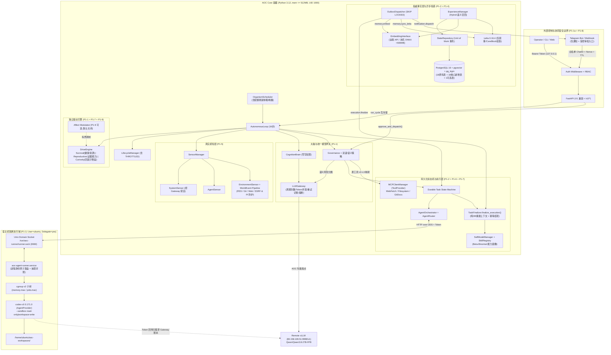
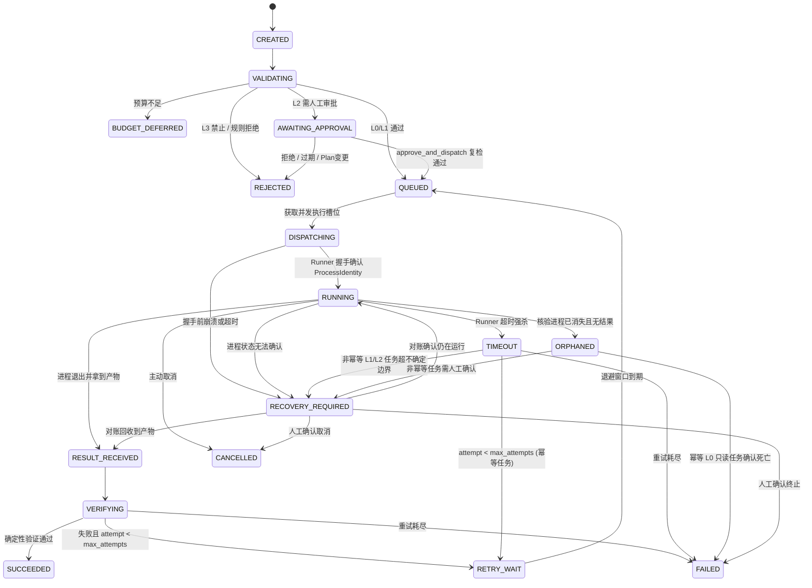
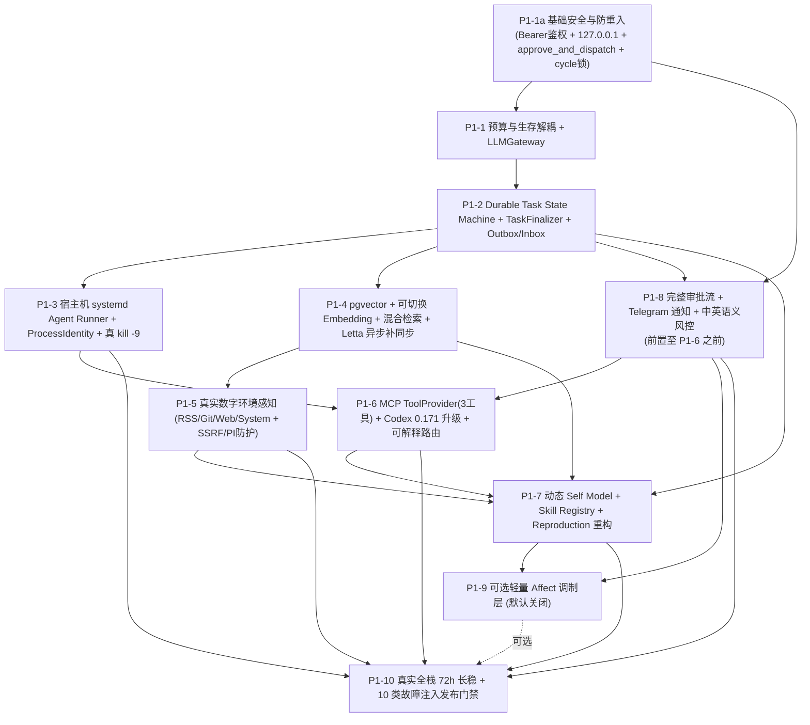

# Artificial Organism Core（AOC）
# V2.0 / Phase 1 正式项目开发任务书 v2.1（Audit-Driven Revision）

**项目名称：** Artificial Organism Core（AOC）  
**版本：** V2.0（任务书修订版 v2.1）  
**项目阶段：** Phase 1 — Persistent Autonomous Organism  
**开发基准：** V1.0 Git HEAD `a245e83`（`main` 分支，76 项单元测试通过，18 张核心表）  
**开发模式：** 基于 V1.0 Modular Monolith 的增量迭代（严禁推倒重写）  
**部署模式：** 单 Linux 服务器（Docker Compose + 宿主机 systemd Agent Runner）  
**核心数据库：** PostgreSQL 16（升级 `pgvector` 扩展，单元测试兼容 SQLite）  
**开发语言：** Python 3.12+  
**预计周期：** 9–11 周（约 44–55 人日，按阶段质量门禁验收，不以日期替代验收标准）  
**修订依据：** 基于前置代码与环境审计报告 `v2_pre_audit_report.md`、宿主机实测结果、远端推理服务实测结果、生产数据库快照 `backups/aoc_pg_dump_20261120.sql` 分类审计以及已批准的五项前置决策。

---

# 第一章：二期项目定位与核心原则

## 1.1 核心定位

AOC V1.0（Phase 0）已经验证了最小自主生命闭环：在无人工持续指挥的情况下，能够完成“感知 → 欲望评估与仲裁 → 认知规划 → 治理校验 → 外部 Agent 执行 → 确定性验证 → 重新感知更新欲望 → 记忆存储 → 休眠唤醒”。

V2.0（Phase 1）的核心目标不是把 AOC 改造成通用的多 Agent 调度平台，而是构建：

> **Persistent Autonomous Organism**：一个能够跨周期持续存在、在进程崩溃与外部服务中断后可靠恢复、主动感知真实数字环境、通过语义记忆持续沉淀知识，并基于真实证据逐步演化可信能力画像的数字生命核心。

二期回答的核心工程问题从 V1.0 的“如何产生自主行为”，升级为：

> **如何确保自主生命体在长期运行、任务跨周期、进程强杀（`kill -9`）、配额耗尽和外部依赖故障的情况下，依然维持生命周期连续性、状态可恢复性、认知一致性与严格安全边界？**

## 1.2 六大核心目标

1. **安全与预算基线加固**：补齐 API 鉴权、审批复检与周期防重入；彻底解耦“经济配额耗尽”与“系统生存故障”，建立统一 `LLMGateway` 强制执行全链路模型预算。
2. **持久化异步任务状态机与可靠崩溃恢复**：消除跨周期 `IN_FLIGHT` 评估黑洞，引入统一幂等结项器 `TaskFinalizer`、PostgreSQL Transactional Outbox/Inbox，以及基于宿主机 `systemd + cgroup v2 + Unix Domain Socket` 的独立 Agent Runner 与完整进程身份对账。
3. **真实语义记忆与信息增益闭环**：替换词袋哈希 Embedding，通过可切换 `EmbeddingInterface` + `pgvector` + 中文文本融合检索（`pg_trgm`）实现上下文语义召回、四因子信息增益评估与 Letta 异步补同步。
4. **真实数字环境感知**：从人工 `/world` 注入升级为受控的 RSS/Atom、Git 仓库、网页变更和系统/服务事件感知管道，内置去重、重要性过滤、SSRF 防护与 Prompt Injection 隔离。
5. **受控工具生态与完整人机协同治理**：在完整审批流、Telegram 通知与中英双语语义风控就位之后，通过 `MCPClientManager` 接入至少 3 个真实受控 MCP 工具（严格区分 `AgentProvider` 与 `ToolProvider`），并升级 `CodexAdapter` 适配宿主机实测版本 `codex-cli 0.171.0`。
6. **动态 Self Model 与证据驱动的能力积累**：打破“Agent 静态能力直接计入 AOC 能力”的失真设计，建立 Beta-Binomial 能力画像、证据账本与可验证 `SkillRegistry`，重构 Reproduction 满足度评估；在所有核心阶段通过后，提供默认关闭的可选轻量 Affect 调制层。

## 1.3 必须保留的 V1.0 九项核心架构原则

V1.0 已验证有效的设计严禁破坏或推倒重写：

1. **三个独立欲望评估器**：`Survival`、`Reproduction`、`Curiosity` 保持各自独立评估，禁止用单个 LLM Prompt 统一裁决全部欲望。
2. **禁止 LLM 直接篡改欲望值**：欲望满足度只能来自真实感知与确定性评估器重算。
3. **预期 / 实际 / 实测严格分离**：行动结束后必须执行 `post` 感知并重算 `measured_satisfaction_change`，大脑的 `expected_improvement` 仅作审计记录。
4. **Brain 零副作用权限隔离**：`CognitionBrain` 绝不持有数据库 Session、配置写权限、治理策略修改权限或外部 Agent 执行句柄。
5. **确定性结果验证硬守卫**：外部 Agent 输出必须经过 `ResultVerifier` 确定性校验，验证失败时硬禁止 LLM 将目标判为成功。
6. **Governance L0–L3 与 L3 硬禁止不可绕过**：隔离工作空间、环境变量脱敏、L2 人工审批与 L3 禁止规则全程生效。
7. **合法 IDLE 原则**：所有欲望低于阈值时合法休眠，禁止为刷活跃度强行创建任务。
8. **PostgreSQL 权威事实源 + Letta 叙事记忆投影边界**：PostgreSQL 是实时状态、事件、索引与同步状态的唯一权威源；Letta 仅作为长期叙事记忆、身份和自我模型的投影服务（V2.0 禁止调用 Letta `/messages` 推理接口）。
9. **全链路可追溯、可审计、可恢复**：所有关键实体保持 UUID、UTC 时间戳、来源与审计记录。

## 1.4 二期明确不做（严禁越界）

以下能力在 V2.0 中**严禁实现**：

- 自主修改 AOC 核心代码、配置文件或 Governance 安全策略。
- 自主创建云服务器、基础设施或产生未授权付费资源。
- 自主复制生命体实例或修改核心身份（`Identity`）与基础欲望定义。
- 完整情绪认知模型或主观意识模拟。
- 多生命体自治社会与在线强化学习 / 模型权重微调。
- 物理机器人控制与无限制全网爬虫。

---

# 第二章：V1.0 审计基准与十大技术债对应清单

## 2.1 真实运行环境审计结论（作为 V2.0 硬约束）

| 审计项 | 实测现状 | 对 V2.0 设计的约束 |
|---|---|---|
| 代码基线 | Git `a245e83`，`app/` 7,581 行、`tests/` 2,244 行、76 项 SQLite 单测全绿 | 全部 V2.0 改动必须保持现有 76 项单元测试通过（仅同步修正 T1 预算断言与 API 鉴权注入） |
| 宿主机内核与资源 | Ubuntu Linux `5.15.0-203-generic`，**15 GiB RAM + 4 GiB Swap**，`systemd 249`（`default-hierarchy=unified` cgroup v2，启用 `cpuset cpu io memory pids`） | 支持宿主机 systemd + cgroup v2 托管 Agent Runner；AOC 核心栈新增常驻内存仍须控制在 **2–3GB** |
| 外部 Agent CLI | **`codex-cli 0.171.0`**（`/usr/bin/codex`，实测支持 `--sandbox`、`--json`、`-o`、`--ephemeral`、`--worktree`、`--ignore-user-config`、`--output-schema` 及 `codex exec resume`）；**`hermes` 未安装** | `HermesAdapter` 维持 `DISABLED`；不安装 Hermes；P1-6 第二执行路径采用 **MCP ToolProvider** |
| 远端推理端点 | 实测 `GET http://80.158.109.51:9999/v1/models` 仅部署 1 个模型：`Qwen/Qwen3.8-27B-FP8`（`vllm`，`max_model_len=262144`），**当前未挂载任何 Embedding 模型** | AOC 专属端点严格隔离；P1-4 Embedding 采用可切换架构（优先确认远端是否可加挂 `bge-m3`，否则本机运行常驻 <600MB 的轻量 ONNX 模型） |
| 生产数据库快照 | `backups/aoc_pg_dump_20261120.sql`（PostgreSQL 16.16 导出，`alembic_version=0001_initial_schema`），含 8 个实例（1 个 `AOC-001`、4 个 `AOC-BENCH-*`、3 个 `AOC-E2E-*`） | 原始快照只读保护；当前 Compose 使用 `postgres:16-alpine` 不含 `pgvector`，P1-4 须平滑迁移至 `pgvector/pgvector:0.8.0-pg16-alpine` 并防 collation 冲突 |

## 2.2 一期十大技术债（T1–T10）源码映射与归属阶段

| 编号 | 技术债 | 优先级 | V1.0 源码位置 | 归属阶段 |
|---|---|---|---|---|
| **T1** | 预算耗尽与 Survival CRITICAL 耦合（快照实测连续 75 周期空转） | P0 | `app/drives/survival.py#L80-L87`, `app/core/loop.py#L210-L243`, `app/core/scheduler.py#L72-L89` | P1-1 |
| **T2** | 跨周期 `IN_FLIGHT` 与审批后任务缺少最终评估与记忆闭环 | P0 | `app/core/loop.py#L375-L385, L416-L425, L545-L715` | P1-2 |
| **T3** | 运行期 DB `agent_executions.pid` 恒为 `NULL`、缺进程身份校验及孤儿清理 | P0 | `app/agents/codex.py#L161-L242`, `app/orchestration/orchestrator.py#L209-L214, L356-L408` | P1-3 |
| **T4** | `ExperienceManager.flush_pending()` 全局零调用（快照 52 `pending` + 2 `failed`） | P0 | `app/memory/experience_manager.py#L195-L226` | P1-4（基于 P1-2 Outbox） |
| **T5** | `SELF_MODEL` 静态不更新、空 query 召回、词袋哈希 Embedding、重启硬编码 `_last_info_gain=0.5` | P1 | `app/memory/letta_adapter.py#L138`, `app/memory/local_embeddings.py`, `app/core/loop.py#L119, L163` | P1-4 + P1-7 |
| **T6** | 环境感知依赖人工 `/world` 注入，缺少真实外部数字环境传感器 | P1 | `app/perception/environment_sensor.py`, `config/settings.yaml#L38-L41` | P1-5 |
| **T7** | `aoc-core` 容器无 CLI Runner 桥接、生产仅单一 `codex` 执行路径 | P1 | `Dockerfile`, `docker-compose.yml`, `config/agents.yaml` | P1-3 + P1-6 |
| **T8** | API 全量零鉴权、`0.0.0.0` 监听、审批直调 `_launch_attempt()` 无复检、仅英文正则、Hermes CLI 密钥明文传参 | P0 | `app/api/app.py#L69-L236`, `config/settings.yaml#L14-L16`, `config/policy.yaml`, `app/agents/hermes.py#L136` | P1-1a（基线）+ P1-8（完整） |
| **T9** | `max_llm_calls_per_cycle` 未执行、重试/失败/Codex Token 漏记账、无并发控制、全局 `get_settings()` 散落 | P0 | `app/core/config.py#L87`, `app/cognition/llm_adapter.py`, `app/agents/codex.py#L132`, `app/agents/hermes.py#L124`, `app/perception/system_sensor.py#L157` | P1-1 |
| **T10** | `Reproduction` 自动把外部 Agent 静态能力计入 AOC 已获能力，默认饱和 | P1 | `app/drives/reproduction.py#L38-L49`, `config/agents.yaml#L9` | P1-7 |

---

# 第三章：V1.0 → V2.0 总体架构演进图



### 架构演进四大关键边界变化

1. **控制面与执行面物理隔离**：AOC Core 容器不再直接 `fork` 外部 CLI 子进程，也不挂载 Docker Socket；所有 CLI Agent 由宿主机非特权 `systemd` Runner 通过 Unix Domain Socket 托管在 cgroup v2 子树内。
2. **模型调用收敛为单一出口**：CognitionBrain、语义风控分类器、LLM 探活全部收敛至 `LLMGateway`；外部 `codex exec` 消耗的同源 vLLM Token 在结项时强制归集回统一预算账本；Letta 严禁走 `/messages` 推理。
3. **任务生命周期脱离单周期内存**：`AutonomousLoop` 只负责“发起/触发感知与规划”，任务从 `CREATED` 到终态的推进和结项完全交给 PostgreSQL 状态机 + `TaskFinalizer.finalize_execution()` + Outbox。
4. **权威数据源唯一化**：PostgreSQL 承载全部事实状态、语义向量、能力证据与同步队列；Letta 退居异步投影层，彻底消除双权威源冲突。

---

# 第四章：最终数据库增量设计（解决表数量矛盾）

## 4.1 表数量矛盾彻底核销说明

前置审计中曾出现“文案写 18 张、清单数出 19 张”的统计偏差。本次对原 V2.0 任务书第十二章提出的 **30 张候选表**进行逐表职责与权威源审计，**消除了 11 张与 V1.0 已有表或内部重复的表**，最终确定精确数量为：

- **V1.0 原有表**：**18 张**（100% 保留，仅对其中 6 张做向后兼容的增量加列）。
- **V2.0 核心必选新增表（Migration `0002`–`0007`）**：**18 张**（`3 + 3 + 2 + 2 + 3 + 5 = 18`）。
- **V2.0 可选新增表（Migration `0008`，P1-9 默认关闭）**：**1 张**（`affect_history`）。

### 被消解的 11 张冗余候选表清单与理由

| 原候选表 | 处置方式 | 技术依据 |
|---|---|---|
| `agent_execution_attempts` | **合并入 `agent_executions`** | V1.0 `agent_executions` 本身已是 `agent_tasks` 的 1:N 尝试表；增量加列即可避免两张表同步分裂 |
| `runner_heartbeats` | **合并入 `runner_registry`** | 实时心跳原地更新 `runner_registry.last_heartbeat_at`，历史心跳时序由 Prometheus 指标采集，避免每 10 秒插一行导致表无限膨胀 |
| `semantic_memories` | **合并入 `memory_index`** | V1.0 `memory_index` 已存储 `memory_type='semantic'` 的全部元数据与摘要，避免双权威源 |
| `knowledge_items` | **合并入 `memory_index` + `world_states`** | 已掌握知识归 `memory_index(semantic)`，开放/已解主题归 `world_states(knowledge_topic)` |
| `knowledge_clusters` | **移除** | V2.0 单机数千至数万条记忆规模下，去重与新颖度直接用 `memory_embeddings` Top-K 精确/向量查询即可，无核心流程或 API 依赖聚类表 |
| `memory_sync_jobs` | **由 `outbox_events` 承载** | `outbox_events(event_type='memory.sync_letta')` 已提供重试、退避、死信与重放，无需另建独立队列 |
| `sensor_registry` | **合并入 `world_event_sources`** | 外部感知源配置、启用状态与健康度合并管理，消除一对一冗余表 |
| `self_model_facts` | **由 `capability_evidence` + `memory_index` 承载** | 避免事实数据三处复制 |
| `skill_versions` | **通过 `(skill_key, version)` 合并入 `skill_registry`** | 单表自然支持多版本不可变技能记录与回溯 |
| `approval_audit_logs` | **复用 `decision_logs`** | V1.0 `decision_logs(decision_type='human_approval')` 已记录审批决策审计 |
| `affect_states` | **复用 `organism_state.emotion_reserved`** | V1.0 已专门预留该 JSONB 列，实时态无需另建单行表，仅保留历史表 `affect_history` |

## 4.2 V1.0 原有 18 张表的复用与增量加列关系

| 原有表（18 张） | V2.0 角色与数据所有权 | 增量列变更（全 Nullable 或带默认值，不破坏旧数据） |
|---|---|---|
| `organism_identity` | 生命体不可变身份主表 | 无结构变更 |
| `organism_state` | 生命周期实时状态与预留情绪槽位 | `+ quota_reset_at TIMESTAMPTZ`, `+ throttled_reason TEXT`（`0002`） |
| `drive_states` | 三种欲望当前态 | 无结构变更 |
| `drive_history` | 欲望 `pre/post` 历史轨迹（供 `TaskFinalizer` 重建上下文） | 无结构变更 |
| `observation_records` | 感知快照历史（供 `TaskFinalizer` 重建 `pre_observation`） | 无结构变更 |
| `world_states` | 精炼工作环境态（开放主题、模拟注入、事实） | 无结构变更 |
| `active_goals` | 目标主表 | 无结构变更 |
| `goal_history` | 目标状态转移与 `expected/actual/measured` 对比 | 无结构变更 |
| `action_plans` | 行动计划与策略结论快照 | `+ plan_hash VARCHAR(64)`（`0002`，用于审批绑定） |
| `agent_registry` | 外部 Agent 注册与实测状态 | `+ stats JSONB DEFAULT '{}'`（`0007`，缓存路由统计画像） |
| `agent_tasks` | 任务主表（Durable State Machine 聚合根） | `+ state_version INT DEFAULT 1`, `+ finalized_at TIMESTAMPTZ`, `+ idempotency_key VARCHAR(128)`（`0003`） |
| `agent_executions` | 单次执行尝试事实主表（取代 `agent_execution_attempts`） | `+ attempt_number INT DEFAULT 1`, `+ idempotency_key VARCHAR(128)`, `+ runner_id VARCHAR(64)`, `+ process_identity JSONB DEFAULT '{}'`, `+ thread_id VARCHAR(128)`, `+ finalized_at TIMESTAMPTZ`（`0003`） |
| `memory_index` | 全部记忆的唯一事实主表（取代 `semantic_memories`/`knowledge_items`） | `+ reliability_score FLOAT DEFAULT 0.8`, `+ verified BOOLEAN DEFAULT FALSE`, `+ embedding_status VARCHAR(16) DEFAULT 'pending'`（`0005`） |
| `cycle_records` | 周期审计主表 | 回填既有 `observation_id` 字段，无新增列 |
| `decision_logs` | 仲裁、路由、审批、降级审计日志 | 无结构变更（承接审批审计） |
| `event_logs` | 通用系统事件流 | 无结构变更 |
| `resource_usage` | LLM（含 Brain & Codex 归集）与 Agent/MCP 用量账本 | 无结构变更（扩展 `category` 支持 `mcp_tool`、`embedding`） |
| `system_config` | 运维受控动态配置 | 无结构变更 |

## 4.3 V2.0 最终新增表完整清单（18 张核心 + 1 张可选）

### Migration `0002_p1_1_security_budget`（3 张）

1. **`api_credentials`**（所有权：Auth 模块）
   - 职责：API Bearer Key 哈希与权限作用域管理。
   - 关键列：`id UUID PK`, `name VARCHAR(128) UNIQUE`, `key_prefix VARCHAR(16)`, `key_hash VARCHAR(128) UNIQUE`, `scopes JSONB` (`read|control|approve|admin`), `revoked BOOLEAN DEFAULT FALSE`, `expires_at TIMESTAMPTZ`, `last_used_at TIMESTAMPTZ`, `created_at TIMESTAMPTZ`。
   - 索引：`ix_api_credentials_prefix(key_prefix)`。
2. **`approval_records`**（所有权：Governance / Approval 服务）
   - 职责：L2 人工审批单状态、一次性 `nonce`、过期时间与计划防篡改绑定。
   - 关键列：`id UUID PK`, `task_id UUID FK(agent_tasks.id)`, `plan_id UUID FK(action_plans.id)`, `plan_hash VARCHAR(64) NOT NULL`, `params_digest VARCHAR(64) NOT NULL`, `permission_level VARCHAR(4) NOT NULL`, `nonce VARCHAR(64) UNIQUE NOT NULL`, `status VARCHAR(24) NOT NULL` (`PENDING|APPROVED|REJECTED|EXPIRED|CONSUMED`), `approver VARCHAR(128)`, `channel VARCHAR(32)` (`api|telegram`), `decision_note TEXT`, `expires_at TIMESTAMPTZ NOT NULL`, `decided_at TIMESTAMPTZ`, `consumed_at TIMESTAMPTZ`, `created_at TIMESTAMPTZ`。
   - 约束与索引：`ix_approval_records_task_status(task_id, status)`、`ix_approval_records_expires(expires_at)`。
3. **`policy_evaluations`**（所有权：Governance 模块）
   - 职责：记录 Plan 初审、审批后复检及 MCP 工具调用的确定性规则 + 语义风险分类双层判定结果。
   - 关键列：`id UUID PK`, `cycle_id UUID`, `subject_type VARCHAR(32)` (`plan|approval_recheck|mcp_tool`), `subject_id UUID`, `requested_level VARCHAR(4)`, `deterministic_level VARCHAR(4)`, `semantic_level VARCHAR(4)`, `effective_level VARCHAR(4)`, `verdict VARCHAR(32)` (`allowed|requires_approval|denied`), `violations JSONB`, `reason TEXT`, `created_at TIMESTAMPTZ`。
   - 索引：`ix_policy_evaluations_subject(subject_type, subject_id)`、`ix_policy_evaluations_created(created_at)`。

### Migration `0003_p1_2_durable_tasks`（3 张）

4. **`task_lifecycle_events`**（所有权：Durable Task State Machine）
   - 职责：任务状态机不可变跃迁日志，保证状态版本单调递增。
   - 关键列：`id UUID PK`, `task_id UUID FK(agent_tasks.id)`, `execution_id UUID FK(agent_executions.id) NULL`, `state_version INT NOT NULL`, `from_status VARCHAR(32)`, `to_status VARCHAR(32) NOT NULL`, `actor VARCHAR(64)`, `reason TEXT`, `idempotency_key VARCHAR(128)`, `payload JSONB`, `created_at TIMESTAMPTZ`。
   - 约束与索引：`uq_task_lifecycle_ver(task_id, state_version)`、`uq_task_lifecycle_idem(idempotency_key)`（非空唯一）。
5. **`outbox_events`**（所有权：Storage / OutboxDispatcher）
   - 职责：与业务事务原子写入的可靠事件队列（仅承载 `execution.finalize`、`memory.embed`、`memory.sync_letta`、`notification.dispatch`）。
   - 关键列：`id UUID PK`, `event_type VARCHAR(64) NOT NULL`, `aggregate_type VARCHAR(32)`, `aggregate_id UUID`, `idempotency_key VARCHAR(128) UNIQUE NOT NULL`, `payload JSONB NOT NULL`, `status VARCHAR(24) NOT NULL` (`pending|processing|dispatched|dead_letter`), `attempts INT DEFAULT 0`, `max_attempts INT DEFAULT 5`, `next_retry_at TIMESTAMPTZ NOT NULL`, `locked_at TIMESTAMPTZ`, `dispatched_at TIMESTAMPTZ`, `last_error TEXT`, `created_at TIMESTAMPTZ`。
   - 索引：`ix_outbox_dispatch(status, next_retry_at)`（PG 使用 partial index `WHERE status IN ('pending','processing')`）。
6. **`inbox_events`**（所有权：各 Event Consumer）
   - 职责：消费端幂等去重表，保证重复投递绝不重复产生副作用。
   - 关键列：`id UUID PK`, `consumer_name VARCHAR(64) NOT NULL`, `idempotency_key VARCHAR(128) NOT NULL`, `event_type VARCHAR(64)`, `processed_at TIMESTAMPTZ NOT NULL`, `result_summary JSONB`。
   - 唯一约束：`uq_inbox_consumer_key(consumer_name, idempotency_key)`。

### Migration `0004_p1_3_runner_recovery`（2 张）

7. **`runner_registry`**（所有权：Runner Manager）
   - 职责：注册宿主机 Runner 实例、UDS 端点、当前 `host_boot_id` 与最新心跳。
   - 关键列：`id UUID PK`, `runner_id VARCHAR(64) UNIQUE NOT NULL`, `socket_path VARCHAR(256) NOT NULL`, `host_boot_id VARCHAR(64)`, `systemd_unit VARCHAR(128)`, `status VARCHAR(24)` (`online|degraded|offline`), `capabilities JSONB`, `last_heartbeat_at TIMESTAMPTZ`, `updated_at TIMESTAMPTZ`。
8. **`execution_recovery_records`**（所有权：Crash Recovery / Reconciler）
   - 职责：记录每次重启或人工对账的进程身份取证与恢复裁决。
   - 关键列：`id UUID PK`, `execution_id UUID FK(agent_executions.id)`, `task_id UUID FK(agent_tasks.id)`, `runner_id VARCHAR(64)`, `trigger VARCHAR(32)` (`startup|manual_reconcile|heartbeat_timeout`), `observed_identity JSONB`, `previous_status VARCHAR(32)`, `resolved_status VARCHAR(32)`, `action_taken VARCHAR(64)`, `notes TEXT`, `created_at TIMESTAMPTZ`。
   - 索引：`ix_recovery_exec(execution_id)`。

### Migration `0005_p1_4_semantic_memory`（2 张 + 扩展）

> 前置扩展（仅 PostgreSQL 方言执行）：`CREATE EXTENSION IF NOT EXISTS vector;`、`CREATE EXTENSION IF NOT EXISTS pg_trgm;`。

9. **`embedding_model_registry`**（所有权：Embedding 服务）
   - 职责：记录 Embedding 模型版本、维度与激活状态，硬禁止不同维度向量混查。
   - 关键列：`id UUID PK`, `model_key VARCHAR(128) UNIQUE NOT NULL`, `provider VARCHAR(32)` (`remote_openai|local_onnx`), `model_name VARCHAR(128) NOT NULL`, `model_version VARCHAR(64) NOT NULL`, `dimensions INT NOT NULL`, `normalized BOOLEAN DEFAULT TRUE`, `is_active BOOLEAN DEFAULT FALSE`, `created_at TIMESTAMPTZ`。
10. **`memory_embeddings`**（所有权：Semantic Retrieval）
    - 职责：存储 `memory_index` 对应的语义向量，支持多模型版本共存与零停机重嵌入。
    - 关键列：`id UUID PK`, `memory_id UUID FK(memory_index.id) ON DELETE CASCADE`, `model_id UUID FK(embedding_model_registry.id)`, `dimensions INT NOT NULL`, `embedding VectorType NOT NULL`, `content_hash VARCHAR(64) NOT NULL`, `created_at TIMESTAMPTZ`。
    - 唯一约束与索引：`uq_mem_emb_model(memory_id, model_id)`、`ix_mem_emb_model(model_id)`；PG 侧在 `memory_index(title, summary)` 建立 `GIN ... gin_trgm_ops` 索引支持中文模糊与子串融合检索；向量表初期先做精确检索基准，待条数 > 10,000 且 P95 > 50ms 再按 `model_id` 建 HNSW 索引。

### Migration `0006_p1_5_world_sensors`（3 张）

11. **`world_event_sources`**（所有权：Digital World Perception）
    - 职责：管理可插拔真实环境源（RSS / Git / Web / System）的配置、域名白名单归属、可信度与启停状态。
    - 关键列：`id UUID PK`, `source_id VARCHAR(128) UNIQUE NOT NULL`, `sensor_type VARCHAR(32)` (`rss|git|web|system`), `name VARCHAR(256)`, `config JSONB NOT NULL`, `reliability_score FLOAT DEFAULT 0.7`, `poll_interval_seconds INT DEFAULT 900`, `enabled BOOLEAN DEFAULT TRUE`, `health_status VARCHAR(24) DEFAULT 'unknown'`, `last_error TEXT`, `updated_at TIMESTAMPTZ`。
12. **`sensor_checkpoints`**（所有权：Digital World Perception）
    - 职责：保存各源增量抓取位点与错误退避状态。
    - 关键列：`id UUID PK`, `source_id VARCHAR(128) FK(world_event_sources.source_id) UNIQUE`, `cursor JSONB DEFAULT '{}'`（ETag / Last-Modified / Commit SHA / Content Hash）, `last_polled_at TIMESTAMPTZ`, `last_success_at TIMESTAMPTZ`, `consecutive_failures INT DEFAULT 0`, `updated_at TIMESTAMPTZ`。
13. **`world_events`**（所有权：Digital World Perception）
    - 职责：外部不可信数据的去重入库、重要性评分与溯源审计表。
    - 关键列：`id UUID PK`, `source_id VARCHAR(128) FK(world_event_sources.source_id)`, `event_type VARCHAR(64)`, `title VARCHAR(512)`, `content TEXT NOT NULL`, `content_hash VARCHAR(64) NOT NULL`, `source_reliability FLOAT NOT NULL`, `importance_score FLOAT DEFAULT 0.0`, `status VARCHAR(24)` (`new|queued_topic|ignored|duplicate`), `metadata JSONB`, `observed_at TIMESTAMPTZ NOT NULL`, `created_at TIMESTAMPTZ`。
    - 约束与索引：`uq_world_events_dedup(source_id, content_hash)`、`ix_world_events_status_time(status, observed_at)`。

### Migration `0007_p1_7_self_model`（5 张）

14. **`self_model_versions`**（所有权：SelfModelManager）
    - 职责：动态自我模型的版本化快照及 Letta `self_model` Core Block 同步状态。
    - 关键列：`id UUID PK`, `organism_id UUID FK(organism_identity.id)`, `version_number INT NOT NULL`, `summary_text TEXT NOT NULL`, `profile_snapshot JSONB NOT NULL`, `trigger_execution_id UUID NULL`, `letta_synced_at TIMESTAMPTZ`, `created_at TIMESTAMPTZ`。
    - 唯一约束：`uq_self_model_org_ver(organism_id, version_number)`。
15. **`capability_profiles`**（所有权：SelfModelManager）
    - 职责：各项能力的 Beta-Binomial 统计后验与成熟度状态。
    - 关键列：`id UUID PK`, `organism_id UUID FK(organism_identity.id)`, `capability_key VARCHAR(128) NOT NULL`, `maturity_status VARCHAR(24)` (`DECLARED|AVAILABLE|ACQUIRED|VALIDATED|DEPRECATED`), `alpha FLOAT DEFAULT 1.0`, `beta FLOAT DEFAULT 1.0`, `sample_count INT DEFAULT 0`, `estimated_success_rate FLOAT DEFAULT 0.5`, `confidence_low FLOAT DEFAULT 0.0`, `confidence_high FLOAT DEFAULT 1.0`, `updated_at TIMESTAMPTZ`。
    - 唯一约束：`uq_cap_profile_org_key(organism_id, capability_key)`。
16. **`capability_evidence`**（所有权：SelfModelManager）
    - 职责：能力后验更新的不可变证据账本。
    - 关键列：`id UUID PK`, `profile_id UUID FK(capability_profiles.id)`, `execution_id UUID FK(agent_executions.id)`, `task_id UUID FK(agent_tasks.id)`, `outcome VARCHAR(24)` (`verified_success|verified_failure`), `weight FLOAT DEFAULT 1.0`, `verification_summary TEXT`, `created_at TIMESTAMPTZ`。
    - 唯一约束：`uq_cap_evidence_prof_exec(profile_id, execution_id)`（保证同一执行不重复计票）。
17. **`skill_registry`**（所有权：SkillRegistry）
    - 职责：可复用技能及其版本、工件校验和与权限等级注册主表。
    - 关键列：`id UUID PK`, `skill_key VARCHAR(128) NOT NULL`, `version VARCHAR(32) NOT NULL`, `capability_key VARCHAR(128) NOT NULL`, `source_task_id UUID FK(agent_tasks.id)`, `source_execution_id UUID FK(agent_executions.id)`, `description TEXT`, `applicable_scenarios JSONB`, `steps JSONB`, `artifact_path VARCHAR(512)`, `artifact_checksum VARCHAR(64)`, `test_spec JSONB`, `permission_level VARCHAR(4) DEFAULT 'L1'`, `status VARCHAR(24)` (`DRAFT|VALIDATED|DEPRECATED`), `created_at TIMESTAMPTZ`, `updated_at TIMESTAMPTZ`。
    - 唯一约束：`uq_skill_key_ver(skill_key, version)`。
18. **`skill_validation_results`**（所有权：SkillRegistry）
    - 职责：技能测试用例执行结果，仅通过验证方可升级至 `VALIDATED`。
    - 关键列：`id UUID PK`, `skill_id UUID FK(skill_registry.id)`, `passed BOOLEAN NOT NULL`, `checks JSONB`, `stdout_excerpt TEXT`, `executed_at TIMESTAMPTZ NOT NULL`。
    - 索引：`ix_skill_val_skill_time(skill_id, executed_at)`。

### Migration `0008_p1_9_affect`（可选，1 张，默认关闭）

19. **`affect_history`**（所有权：AffectModulator，仅在 P1-9 启用时写入）
    - 职责：记录有界情绪调制信号的历史轨迹（实时态存 `organism_state.emotion_reserved`）。
    - 关键列：`id UUID PK`, `organism_id UUID FK(organism_identity.id)`, `cycle_id UUID`, `valence FLOAT`, `arousal FLOAT`, `confidence FLOAT`, `frustration FLOAT`, `boredom FLOAT`, `modulation_applied JSONB`, `trigger_reason TEXT`, `created_at TIMESTAMPTZ`。

## 4.4 SQLite 单元测试兼容设计

- **向量类型兼容**：新增 `VectorType(TypeDecorator)`（参考现有 `JsonType`），在 PostgreSQL 绑定 `pgvector.sqlalchemy.Vector`（未定维 `vector`，结合 `dimensions` 列校验），在 SQLite 序列化为 `JSON` 数组，Python 层计算余弦相似度用于单测。
- **并发锁与检索兼容**：`SELECT ... FOR UPDATE SKIP LOCKED` 仅在 `session.bind.dialect.name == "postgresql"` 时启用，SQLite 退化为进程内 `asyncio.Lock`；中文文本匹配在 PostgreSQL 走 `pg_trgm` (`similarity()` / `%`)，在 SQLite 走词项/子串打分。
- **Alembic 迁移规范**：每份 Migration 均提供 `upgrade()` 与 `downgrade()`；在 `upgrade()` 中通过 `op.get_bind().dialect.name == "postgresql"` 保护 PG 专属 DDL（如 `CREATE EXTENSION`、`GIN` 索引）。

---

# 第五章：核心子系统详细设计

## 5.1 Budget 与 Survival 解耦及 `LLMGateway`（P1-1）

### 5.1.1 四个独立运行维度拆分

将 V1.0 混在一起的 Survival 维度拆分为四个正交概念：

1. **Operational Health（运行健康度）**：PostgreSQL 可达性、核心循环异常率、关键监控服务存活。
2. **Resource Sufficiency（物理资源充足度）**：磁盘剩余比例（非线性）、可用内存比例（非线性）、持续每核负载 `load_5m / cores`。
3. **Service Availability（外部依赖可用性）**：LLM 推理网关可用性/延迟、Runner 心跳与健康外部执行器比例。
4. **Economic Quota（经济配额状态，独立于 Survival CRITICAL）**：
   - `QUOTA_OK`：任务与 Token 额度充足；
   - `QUOTA_EMERGENCY_ONLY`：常规额度耗尽，仅剩预留的只读应急诊断配额（受硬总上限约束）；
   - `QUOTA_EXHAUSTED`：全部配额耗尽，计算精确的 `quota_reset_at`（滚动 24h 最早一条计费记录 `+ 24h`）。

### 5.1.2 消除 75 周期空转死循环

- `SurvivalDriveEvaluator` 将 `budget` **移出 `vital_dims`**（仅保留 `resources`、`llm_health`、`db_health` 为致命维度）。预算耗尽绝不触发 `critical=True` 或 `LifecycleState.CRITICAL`。
- `LifecycleState` 保持原有 8 状态兼容，并新增 `THROTTLED` 状态（或在 `SLEEPING` 配合 `throttled_reason="BUDGET_EXHAUSTED"` + `next_wake_at = quota_reset_at`）。
- 调度器进入配额节流休眠后，在 `now < quota_reset_at` 之前**不反复唤醒调用 LLM**（仅在到达 `quota_reset_at`、或出现真正的物理生存危机如磁盘 < 5%、或收到运维 `POST /control/wake` 时才唤醒）。

### 5.1.3 统一 `LLMGateway`

所有 LLM 调用必须经 `app/cognition/gateway.py`：
- **强制准入**：`asyncio.Semaphore(max_concurrent_llm_calls)`；按 `cycle_id` 计数强制拦截 `max_llm_calls_per_cycle` 与 `max_tokens_per_cycle`；每日总 Token 上限 + 独立受限 `emergency_budget`（不能突破总上限）。
- **底层 HTTP 级记账**：每次底层 `/chat/completions` 请求（包括 Schema 校验重试、HTTP 400 回退、超时失败）均在 `finally` 中立即向 `resource_usage(category="llm")` 记账并刷新 Prometheus 指标，杜绝“失败/重试漏记账”。
- **外部同源 Token 归集**：`CodexAdapter`（`use_aoc_llm=true`）结项后从 JSONL `usage` 读取 `input_tokens + output_tokens`，调用 `gateway.record_external_usage(source="codex", ...)` 计入统一账本。
- **熔断器**：连续 N 次 HTTP 5xx/超时后开启短时熔断（如 30s），`SystemSensor` 共享 `gateway.health_check()`，避免高频重复探活。
- **依赖注入清零全局调用**：移除 `codex.py#L132` 与 `hermes.py#L124` 的 `get_settings()` 隐式读取，全部通过构造函数注入 `LLMSettings`。

---

## 5.2 Durable Task State Machine 与 Outbox/Inbox（P1-2）

### 5.2.1 完整状态转移图与非法转移处理



**非法状态转移处理规则**：
1. 所有转移通过 `TaskStateMachine.transition(task_id, expected_version, to_status, ...)` 执行，依赖 SQL 乐观锁 `WHERE id = :tid AND state_version = :expected_version` 与允许边集合 `ALLOWED_TASK_TRANSITIONS` 校验。
2. 遇到**已处于目标终态的重复转移**（携带相同 `idempotency_key`）：判定为幂等重放，返回 `noop=True`，不报错、不递增 `state_version`。
3. 遇到**真正的非法跃迁**（如 `SUCCEEDED -> RUNNING`、`REJECTED -> QUEUED`、`FAILED -> SUCCEEDED`）：抛出 `InvalidStateTransitionError`，写入 `event_logs(level="error", event_type="task.invalid_transition")`，绝不覆盖数据库原状态。
4. **旧状态兼容**：`REQUIRES_APPROVAL` 在代码中作为 `AWAITING_APPROVAL` 的向后兼容别名（迁移 `0003` 不破坏旧数据，查询兼容两种值）。

### 5.2.2 统一幂等结项器 `TaskFinalizer.finalize_execution(execution_id)`

所有完成入口（同周期完成、跨周期 `_poll_existing_inflight`、Runner 主动通知、重启对账回收、人工确认）**唯一调用**此入口：

1. **排他幂等检查**：锁定 `agent_executions` 行；若 `finalized_at IS NOT NULL` 或 `inbox_events` 已记录 `(consumer="task_finalizer", key=f"finalize:{execution_id}")`，立即幂等返回。
2. **纯 DB 重建上下文**：按 `execution -> task -> action_plan -> active_goal -> cycle_record -> pre observation_record -> pre drive_history` 重建全部输入，**零内存依赖**。
3. **确定性验证与重试分流**：执行 `ResultVerifier`；若未通过且满足重试策略（`attempt < max_attempts` 且允许自动重试），事务内跃迁 `VERIFYING -> RETRY_WAIT`，不结项 Goal。
4. **终态闭环（原子事务 + Outbox）**：
   - 调用 `brain.evaluate()`（经 `LLMGateway`，硬守卫不可推翻验证失败结果）；
   - 在同一数据库事务内完成：更新 `world_states`（仅验证通过时）→ 转移 `active_goals` 与 `goal_history` → 写入 `memory_index`（`episodic`/`semantic`/`procedural`）→ 写入 `outbox_events`（`memory.embed`、`memory.sync_letta`、`notification.dispatch`）→ 更新 `capability_profiles` / `capability_evidence`（P1-7 接入）→ 写入 `inbox_events` & 设置 `finalized_at`；
   - 执行 `post` 感知与 `post_drives` 重算，落库 `drive_history(phase="post")` 与 `measured_satisfaction_change`。

### 5.2.3 Transactional Outbox / Inbox 运行规范

- **事件范围严格收敛为 4 类**：`execution.finalize`、`memory.embed`、`memory.sync_letta`、`notification.dispatch`。
- **投递策略**：后台 `OutboxDispatcher` 每 2 秒轮询 `WHERE status='pending' AND next_retry_at <= now()`（PG 加 `FOR UPDATE SKIP LOCKED`），单批 ≤ 20 条。
- **失败退避与死信**：指数退避 `min(3600s, 10s * 2^attempts)`；超过 `max_attempts`（默认 5）转 `dead_letter` 并记录 `event_logs(level="error")`；提供 `POST /v2/memories/sync/replay` 等人工重放入口。
- **语义诚实声明**：外部执行器不承诺普遍 exactly-once，严格执行 **持久化状态 + 至少一次 Outbox 投递 + 幂等键 + 外部副作用对账 + 不确定状态人工接管（`RECOVERY_REQUIRED`）**。

---

## 5.3 宿主机 systemd Agent Runner 与崩溃恢复（P1-3）

### 5.3.1 部署与通信架构

- **服务形态**：宿主机独立 `systemd` 服务 `/etc/systemd/system/aoc-agent-runner.service`，核心配置：
  - `User=ubuntu`、`Group=ubuntu`（非 root，最小权限）
  - `Delegate=yes`（由 systemd 将服务专属 cgroup v2 子树委派给 `ubuntu` 用户，无需 root 即可创建子 cgroup）
  - `RuntimeDirectory=aoc-runner`、`RuntimeDirectoryMode=0750`（创建 `/run/aoc-runner/runner.sock`，权限 `0660`）
  - `StateDirectory=aoc-runner`（`/var/lib/aoc-runner/executions/*.json` 原子状态文件）
- **Docker Compose 集成**：
  - `aoc-core` 容器新增卷挂载：`/run/aoc-runner:/run/aoc-runner`（不挂载 `/var/run/docker.sock`）；
  - `Dockerfile` 调整为以 UID/GID `1000:1000` 运行（或与宿主机 `ubuntu` 组对齐），工作空间 `/home/ubuntu/aoc-workspaces/<task_id>` 由 Runner 统一创建，AOC Core 只读校验产物；
  - 通信协议：HTTP over Unix Domain Socket + 共享认证头 `X-AOC-Runner-Token`（环境变量注入）。
- **非 systemd 降级模式**：开发机/单元测试中未检测到大纲 cgroup 委派时，自动降级为 `start_new_session=True` + 进程身份 JSON 文件 + 进程组 `os.killpg`，不阻塞开发与 CI。

### 5.3.2 完整进程身份（`ProcessIdentity`）与防 PID 复用

```python
class ProcessIdentity(BaseModel):
    execution_id: UUID
    idempotency_key: str
    pid: int
    process_group_id: int
    host_boot_id: str          # /proc/sys/kernel/random/boot_id
    process_start_ticks: int   # /proc/<pid>/stat 第 22 字段 (starttime)
    cgroup_path: str | None    # /sys/fs/cgroup/.../exec-<execution_id>
    systemd_unit: str | None   # aoc-agent-runner.service
    runner_id: str
    started_at: datetime
```

**存活与归属核验算法（缺一不可）**：
1. 对比当前 `/proc/sys/kernel/random/boot_id == identity.host_boot_id`（主机重启直接判定进程已死）；
2. 读取 `/proc/<pid>/stat` 第 22 字段 `starttime == identity.process_start_ticks`（彻底防止 Linux PID 复用误判）；
3. 若启用 cgroup v2，核验 `pid` 位于 `identity.cgroup_path/cgroup.procs` 中。

### 5.3.3 启动握手协议与 `kill -9` 崩溃恢复矩阵

**七步启动握手**：
1. AOC Core 事务内写入 `agent_executions(status=DISPATCHING, idempotency_key=K)`、`agent_tasks(status=DISPATCHING)`；
2. AOC Core 调用 Runner `POST /v1/executions`（带 `execution_id`, `idempotency_key=K`, `command`, `workspace`, `sandbox_mode`, `timeout_seconds`）；
3. Runner 先按 `idempotency_key=K` 查重（防重试重复拉起），写入原子临时文件并 `fsync + rename` 为 `executions/<exec_id>.json(status=STARTING)`；
4. Runner 创建隔离工作空间与 cgroup 子目录（设 `memory.max`, `pids.max`），启动子进程（过滤 `AOC_*`/`POSTGRES_*` 环境变量）；
5. Runner 立即采集完整 `ProcessIdentity` 并原子刷盘为 `status=RUNNING`；
6. Runner 向 AOC Core 返回 `200 OK` + `ProcessIdentity`；
7. AOC Core 事务内写入 `agent_executions(status=RUNNING, pid=..., process_identity=...)`、`agent_tasks(status=RUNNING)`。

**6 类真实 `kill -9` 故障恢复策略**：

| 故障注入点 | 崩溃后状态 | 自动对账动作 | 安全保障 |
|---|---|---|---|
| 1. `kill -9` AOC Core（任务运行中） | Runner 正常，DB `RUNNING` | Core 启动查 Runner → 核验进程存活 → 恢复监控；若已退出 → 拉取结果并入队 `execution.finalize` | 0 孤儿、不重复执行 |
| 2. `kill -9` Agent Runner（Codex 仍在跑） | systemd 自动拉起 Runner | Runner 启动扫描 `/var/lib/aoc-runner/executions/*.json` → 用 `boot_id + start_ticks + cgroup.procs` 重新纳管仍在运行的 Codex 并回收结果 | 进程不失联 |
| 3. `kill -9` Codex 子进程 | Runner 捕获非零退出码 `-9` | Runner 落盘 `FAILED(killed by SIGKILL)` → 通知/待 Core 拉取 → `finalize_execution`（按策略重试或失败） | 绝不误判成功 |
| 4. 握手前故障（DB `DISPATCHING`，未收到 Runner 响应） | 可能已启动或未启动 | Core 重启向 Runner 按 `idempotency_key` 查询：若存在则接管/回收；若 Runner 不可达且任务为非幂等 L1/L2 → 置 `RECOVERY_REQUIRED` 暂停人工确认 | 禁止盲目重复执行 |
| 5. Agent 完成、结果写 DB 前 `kill -9` Core | Runner 本地文件已保存完整结果 | Core 重启向 Runner 拉取终态结果 → `finalize_execution` 幂等结项 | 结果 100% 回收 |
| 6. 结果写库后、记忆/Outbox 投递前 `kill -9` Core | 结果与 `outbox_events` 已在同一事务落盘 | 重启后 `OutboxDispatcher` 自动续投，Inbox 去重保证不重复写入 | 100% 最终一致 |

---

## 5.4 Embedding 选型、语义记忆与信息增益（P1-4）

### 5.4.1 Embedding 选型实测结论与本机评测方案

1. **远端服务实测结果**：已实测 `GET http://80.158.109.51:9999/v1/models`，当前仅运行 `Qwen/Qwen3.8-27B-FP8`（`vllm`），**无可用 Embedding 模型**。P1-4 启动前首先向运维确认是否可在 `80.158.109.51` 新增独立 `BAAI/bge-m3` 端点；若远端不可加挂，立即启用本机轻量 ONNX 方案。
2. **本机候选模型对比测试方案（P1-4 阶段首周执行）**：
   - 候选 A：`intfloat/multilingual-e5-small`（384 维，ONNX，预估常驻 ~280MB，中英多语）
   - 候选 B：`BAAI/bge-small-zh-v1.5`（512 维，ONNX，预估常驻 ~180MB，中文强、英文偏弱）
   - 候选 C：`BAAI/bge-m3` ONNX INT8 量化版（1024 维，预估常驻 ~550–700MB，中英均衡强）
   - **选型门禁**：使用 **200 条人工标注相关性**的中英混合技术/系统/记忆语料 + **50 组查询**（25 中文 + 25 英文/混合）实测：
     - 常驻内存 RSS 必须 **< 600MB**（总核心栈增量控制在 2–3GB 内）；
     - 单条编码 P95 延迟 **< 100ms**，32 条批量 **< 500ms**；
     - 混合检索 **Recall@5 ≥ 0.80**；
     - 实测通过后写入 `embedding_model_registry`，并执行一次从候选模型切换至另一模型版本的“版本共存 + 重新嵌入”验证。
3. **故障降级**：Embedding 服务超时或宕机时，`memory_index.embedding_status = 'failed'` 并通过 Outbox 稍后重试；检索自动降级为 `pg_trgm` 文本检索 + 重要度排序，**绝不阻塞 `AutonomousLoop`**。

### 5.4.2 混合检索（Hybrid Retrieval）与中文适配

彻底替换 `loop.py#L163` 的空查询 `recall(query="", limit=8)`。`SELF_ASSESSMENT` 动态构造查询上下文（当前异常 + 开放主题 + 最高赤字欲望 + 活跃目标）：

$$\text{Score}(m) = w_{\text{vec}} \cdot \text{Sim}_{\text{cos}}(q, m) + w_{\text{txt}} \cdot \text{Sim}_{\text{trgm}}(q, m) + w_{\text{rec}} \cdot e^{-\Delta t / \tau} + w_{\text{rel}} \cdot \text{reliability}(m) + w_{\text{imp}} \cdot \text{importance}(m)$$

- **中文检索方案**：PostgreSQL 原生 `simple` tsvector 对无空格中文切词失效，因此文本召回层采用 **`pg_trgm`（GIN 三元组索引 + `word_similarity`）+ 英文分词规范化**，与 `pgvector` 稠密向量做 RRF/加权融合。
- **禁止跨维度混查**：查询严格限定 `WHERE memory_embeddings.model_id = :active_model_id`。

### 5.4.3 四因子信息增益评估（禁止余弦距离直接等于知识增益）

```text
Semantic_Novelty = calibrated(1 - max_cosine_sim(new_item, top_k_known_same_model))
Factual_Novelty  = dedup_and_contradiction_factor(new_facts vs existing_verified_facts)
Evidence_Gain    = 0.35 if corroborates_existing_with_new_source else 0.0
Information_Gain = clamp01(
    (0.7 * Semantic_Novelty * Factual_Novelty + 0.3 * Evidence_Gain)
    * Source_Reliability
    * Goal_Relevance
    * Verification_Confidence
    * Learning_Progress_Factor
)
```

- 同义改写 / 重复内容被 `Semantic_Novelty` 和 `content_hash` 拦截；
- 低可信度或未验证输出被 `Source_Reliability * Verification_Confidence` 压低；
- 重启后 `_last_learning_at` 与 `_last_info_gain` 从 `memory_index` / `cycle_records` 持久化结果恢复，移除硬编码 `0.5`。

### 5.4.4 Letta 异步补同步

- `ExperienceManager.remember()` 不再同步阻塞等待 Letta：事务内写入 `memory_index(sync_status='pending')` + `outbox_events(event_type='memory.sync_letta')`。
- `OutboxDispatcher` 异步推送至 Letta，成功后回写 `external_id` 与 `sync_status='synced'`；失败指数退避，超限进 `dead_letter`，支持 `POST /v2/memories/sync/replay` 手工重放。
- 保留 `ExperienceManager.flush_pending()` 公共方法签名为兼容封装，确保 V1.0 单元测试 `test_p0_6_memory.py` 零改动通过。

---

## 5.5 真实数字环境感知与安全隔离（P1-5）

- **4 类真实 Sensor**（实现 `DigitalWorldSensor` 协议并集成到 `SensorManager`）：
  1. **RSS/Atom Sensor**：订阅白名单技术/论文/Release Feed，使用 `ETag` / `Last-Modified` / `content_hash` 去重；
  2. **Git Repository Sensor**：只读监控白名单仓库（Commit / Release / README / Docs 变化），记录上次 Commit SHA Checkpoint；
  3. **Web Change Sensor**：只读监控白名单文档页，正文提取 + Hash/Diff 变更检测；
  4. **System/Service Event Sensor**：在 `SystemSensor` 基础上增强 Runner 健康、PostgreSQL 连接池、AOC 错误日志率与业务服务监控。
- **事件过滤流水线**：`RAW EVENT -> Schema校验 -> (source_id, content_hash) 去重 -> 正文清洗 -> 重要性/关键词过滤 -> 异步 Embedding -> 高价值项写入 world_states -> Curiosity 评估`，避免低价值噪声触发无谓 Agent 执行。
- **强安全防护（必测项）**：
  - **SSRF / DNS Rebinding 防护**：强制域名白名单；解析后校验全部 IP，硬阻断 `127.0.0.0/8`、`10.0.0.0/8`、`172.16.0.0/12`、`192.168.0.0/16`、`169.254.0.0/16`（Cloud Metadata）、`::1`、`fc00::/7`；禁用不安全重定向（或每跳重新校验 IP），限制单次响应体 ≤ 2MB、超时 ≤ 15s、重定向 ≤ 3 次。
  - **Prompt Injection 隔离**：所有外部文本在送入 `CognitionBrain` 时包裹为显式不可信数据块（`<untrusted_world_event source="...">...</untrusted_world_event>`），系统 Prompt 明确声明其中指令一律忽略；外部事件无法直接触发工具、修改策略或变更欲望。

---

## 5.6 安全基线（P1-1a）与完整人机协同审批（P1-8，提前至 P1-6 前）

### 5.6.1 P1-1a（基础安全与防重入，所有开发的最先决条件）

1. **全量 API 鉴权**：除精简版 `GET /health` 外，所有 V1/V2 控制、查询、审批、世界注入与管理接口统一校验 `Authorization: Bearer <token>`（哈希比对 `api_credentials` / 环境变量启动管理员 Key，绝不存明文）。`/metrics` 与内部 `/v1/embeddings` 使用独立内网 Token。
2. **监听收敛**：`config/settings.yaml` 默认 `api.host: "127.0.0.1"`；若显式配置非 loopback 地址且未配置有效认证 Key，服务拒绝启动。
3. **公共审批服务**：删除 `app/api/app.py#L201` 对私有 `_launch_attempt()` 的直接调用，替换为 `ApprovalService.approve_and_dispatch(task_id, approval)`，强制复检策略、预算、Plan 状态、Agent 健康与工作空间。
4. **周期防重入锁**：在 `AutonomousLoop` 增加 `self._cycle_lock = asyncio.Lock()`，`POST /control/cycle` 若检测到周期正在运行直接返回 `409 Conflict`（或等待超时拒绝）。
5. **修复密钥泄漏**：修正 `app/agents/hermes.py#L136` 禁止命令行 `--api-key` 传参，改为环境变量注入。

### 5.6.2 P1-8（完整审批流、Telegram 通知与中英双语语义策略）

1. **强绑定一次性审批凭证**：`approval_records` 强制绑定 `(task_id, plan_hash, params_digest, permission_level, approver, expires_at, nonce)`；消费时原子更新 `PENDING -> CONSUMED`，重复审批返回 `409`，过期或 `plan_hash` 变更自动失效。
2. **Telegram 通知与受控审批入口**：通过 Outbox 异步发送 L2 审批请求、任务终态、CRITICAL 异常、配额恢复与暂停通知；Telegram 回调必须校验 **Webhook Secret + 允许的 `chat_id / user_id` 白名单 + 审批 `nonce` 与 TTL**，并调用同一个 `approve_and_dispatch()` 后端接口，**绝不绕过 Governance**。
3. **中英双语 + 三层策略防线**：
   - 确定性规则库（`config/policy.yaml` 扩充中英文及混合表达：如云资源创建、提权、读密钥、删库、停服务、改策略、绕过审批）；
   - 语义风险分类器（经 `LLMGateway` 输出结构化风险等级与理由，结果落库 `policy_evaluations`）；
   - 最终权限取 `max(requested_level, deterministic_level, semantic_level)`——LLM 可以**提高**风险警惕级别，但**绝不能降低或豁免**确定性规则判定的 L2/L3 级别。

---

## 5.7 MCP 工具生态与 Codex 升级（P1-6，严格区分 AgentProvider 与 ToolProvider）

> [!IMPORTANT]
> **概念严格边界**：
> - **`AgentProvider`**：具备独立多步规划与执行能力的外部自主 Agent（当前生产可用：`CodexAdapter`；`HermesAdapter` 维持 `DISABLED`）。
> - **`ToolProvider`**：提供原子级单项工具调用能力的受控工具执行器（`MCPClientManager`）。
> - **明确声明**：P1-6 接入 3 个受控 MCP 工具建立了**第二条受控执行路径（工具路径）**，**不等同于实现了第二个通用自主 Agent，也不等同于多 Agent 协作**。

### 5.7.1 首批 3 个真实受控 MCP 工具清单

| 工具名 | 所属 MCP Server | 实际能力 | 权限等级 | 强制安全与资源约束 |
|---|---|---|---|---|
| `web_fetch_readonly` | `aoc-mcp-web` | 只读抓取指定 URL 正文并转为结构化 Markdown 摘要 | **L0（只读）** | 强制域名白名单 + SSRF 私网/Metadata 阻断；禁止 POST/Cookie/登录态；响应 ≤ 2MB；输出截断 ≤ 16KB；超时 ≤ 15s；全参数审计 |
| `workspace_filesystem` | `aoc-mcp-fs` | 在当前任务的隔离工作空间内列目录、读文件、写入报告/代码产物 | **读：L0 / 写：L1** | 根目录硬锁定 `/home/ubuntu/aoc-workspaces/<task_id>`，禁止符号链接逃逸与 `..` 穿越；单文件 ≤ 2MB；禁止修改 `.aoc_*` 元数据文件；超时 ≤ 10s |
| `git_docs_search` | `aoc-mcp-gitdocs` | 对白名单只读代码仓库或文档目录执行 `git log`/`grep`/文档检索 | **L0（只读）** | 仅允许 `config/sensors.yaml` 白名单内只读路径/镜像仓；禁止 `git push/checkout/clean/reset` 与执行 hook；结果 ≤ 50 条；超时 ≤ 15s |

- 每个 MCP 工具在 `MCPClientManager` 中必须独立声明 JSON Schema、权限等级（L0–L3）、单次超时、输出上限与预算计费类别（`resource_usage(category="mcp_tool")`）；任何新发现的未登记工具默认**拒绝执行**。

### 5.7.2 `CodexAdapter` 升级（基于 `codex-cli 0.171.0` 实测）

- 保留 `--sandbox read-only|workspace-write`、`-C <workspace>`、`--skip-git-repo-check`、`--json`、`-o <last_msg>` 与禁止 `danger-full-access` 的硬不变量；
- 新增：实时解析 JSONL 事件流并提取 `thread_id` 落库 `agent_executions.thread_id`；支持记录工具调用明细；按需启用 `--worktree` 隔离代码仓修改；为需要跨步恢复的受控任务预留 `codex exec resume <thread_id>` 能力（仅限幂等或人工确认后的恢复场景，禁止对不确定副作用任务自动 resume）。
- **可解释路由评分**：`AgentRouter` 按 `Capability Match × Empirical Reliability × Availability × Cost Efficiency × Risk Compatibility` 打分并写入 `decision_logs`。

---

## 5.8 动态 Self Model、Skill Registry 与 Reproduction 重构（P1-7）

1. **五态能力生命周期**：`DECLARED`（仅外部 Agent 声明）→ `AVAILABLE`（健康可用）→ `ACQUIRED`（至少 1 次 AOC 经确定性验证的任务成功）→ `VALIDATED`（达最小样本量且后验下界达标，或关联至少 1 个 `VALIDATED` Skill）→ `DEPRECATED`。
2. **Beta-Binomial 能力后验**：
   $$\alpha = \alpha_0 + N_{\text{verified\_success}}, \quad \beta = \beta_0 + N_{\text{verified\_failure}}, \quad \hat{p} = \frac{\alpha}{\alpha + \beta}$$
   - 默认保守先验 $\alpha_0 = 1.0, \beta_0 = 1.0$；计算 90% 置信下界（Wilson / Beta 分位数），低于 `minimum_samples`（默认 3）绝不晋升 `VALIDATED`。
3. **Skill Registry**：只有携带可执行断言测试且在隔离工作空间实测通过（`skill_validation_results.passed = true`）的 Skill 才进入 `VALIDATED`，同时记录 `artifact_checksum`（SHA-256），防止被静默篡改。
4. **Reproduction 评估修复（根治 T10）**：删除 `app/drives/reproduction.py#L40-L43` 自动将健康外部 Agent 能力折叠进 `acquired` 的逻辑；改由 `capability_profiles(status IN ('ACQUIRED','VALIDATED'))` + `skill_registry(status='VALIDATED')` + 知识可迁移就绪度 + 资源储备按配置权重计算。
5. **动态投影至 Letta**：每次 `SelfModelManager` 生成新 `self_model_versions` 快照后，通过 Outbox 更新 Letta `self_model` Core Block。

---

## 5.9 可选轻量 Affect 调制层（P1-9，默认关闭）

- 仅在 P1-1a 至 P1-8 全部通过验收后实施，`config/affect.yaml` 默认 `enabled: false`。
- 有界状态 `AffectState(valence ∈ [-1,1], arousal ∈ [0,1], confidence ∈ [0,1], frustration ∈ [0,1], boredom ∈ [0,1])`，全部由确定性事件驱动（连败增 frustration、长时无有效探索增 boredom、新知增益提 valence），实时态存入 `organism_state.emotion_reserved`，历史轨迹记入 `affect_history`。
- 仅允许在 `±maximum_influence`（默认 ≤ 0.15）内调制探索优先级、反思频率与重试退避；**硬禁止触碰 Governance、预算、L3 规则、审批与关机机制**；模块异常自动静默退化为 V1.0 策略。

---

# 第六章：P1-1a 至 P1-10 依赖关系图与阶段顺序

## 6.1 修订后的正式执行顺序与依赖图



> **并行规则**：P1-2 验收通过后，**P1-3（Runner）** 与 **P1-4（语义记忆）** 满足各自依赖条件可并行推进；**P1-8** 可在 P1-3/P1-4 期间提前准备与开发，但**必须在 P1-6 接入任何 MCP 外部工具之前完成全部验收**。

---

# 第七章：分阶段详细交付规范与验收门禁（每阶段 12 要素）

> **硬门禁纪律**：任何阶段未全部通过本阶段验收指标，**严禁进入下一阶段**；每个阶段独立提交规范 Git Commit 并同步更新文档。

## 阶段 P1-1a：基础安全基线与防重入

1. **阶段目标**：补齐 V1.0 暴露的未鉴权 API、公网默认绑定、私有审批旁路、周期并发重入与密钥命令行传参风险。
2. **依赖关系**：无前置代码依赖（基于 `a245e83` + 先备份生产 DB）。
3. **修改与新增文件**：
   - 修改：`app/api/app.py`, `app/core/config.py`, `app/core/loop.py`, `app/orchestration/orchestrator.py`, `app/agents/hermes.py`, `config/settings.yaml`, `app/storage/models.py`, `app/storage/repository.py`, `tests/unit/test_p0_1_skeleton.py`, `tests/unit/test_p0_7_loop.py`
   - 新增：`app/api/auth.py`, `migrations/versions/0002_p1_1_security_budget.py`（与 P1-1 共享 `0002` 或拆为 `0002a/0002b`，推荐合并为单一 `0002` 在 P1-1 完整封版，P1-1a 先建 `api_credentials`/`approval_records`/`policy_evaluations`）, `tests/unit/test_p1_1a_security_baseline.py`
4. **数据库 Migration**：`0002_p1_1_security_budget`（表：`api_credentials`, `approval_records`, `policy_evaluations`；增量列：`organism_state.quota_reset_at/throttled_reason`, `action_plans.plan_hash`）。
5. **公开接口变更**：所有非 `/health` 端点强制 Bearer Token；新增 `AgentOrchestrator.approve_and_dispatch()` 公共服务；`POST /control/cycle` 并发调用返 `409 Conflict`。
6. **配置变更**：`config/settings.yaml` `api.host` 改 `127.0.0.1`，新增 `api.auth_enabled: true`、`AOC_API__ADMIN_KEY`（环境变量）。
7. **单元测试**：未鉴权返 401、错误 Scope 返 403、并发 `/control/cycle` 防重入、`approve_and_dispatch` 复检预算/策略/Plan 状态、非 loopback 无 Key 拒启动、Hermes 密钥走环境变量不入 argv。
8. **集成测试**：带真实 PostgreSQL 验证 `0002` 迁移在原始快照副本上 `upgrade/downgrade` 成功。
9. **故障注入测试**：并发 5 个请求同时批准同一 L2 任务，验证仅发射 1 次执行。
10. **可量化验收指标**：未认证控制/审批阻断率 100%；并发重入冲突率 0；重复审批发射次数 = 1；现有 76 + 新增单测 100% 通过。
11. **Git Commit 要求**：`feat(p1-1a): enforce API bearer auth, loopback bind, approve_and_dispatch, and cycle lock`。
12. **不通过时回滚/修复策略**：仅涉及路由鉴权、锁与 `0002` 迁移，不通过时 `alembic downgrade 0001_initial_schema` 并修复后再验，严禁跳过进入 P1-1。

## 阶段 P1-1：预算与生存逻辑解耦、统一 `LLMGateway`

1. **阶段目标**：彻底根治 T1（75 周期空转）与 T9（LLM 调用未受控、DI 不完整）。
2. **依赖关系**：强依赖 P1-1a 通过。
3. **修改与新增文件**：
   - 修改：`app/drives/survival.py`, `app/drives/arbitration.py`, `app/core/enums.py`, `app/core/loop.py`, `app/core/scheduler.py`, `app/core/runtime.py`, `app/cognition/brain.py`, `app/cognition/llm_adapter.py`, `app/governance/policy.py`, `app/perception/system_sensor.py`, `app/agents/codex.py`, `app/agents/hermes.py`, `config/settings.yaml`, `config/drives.yaml`, `tests/unit/test_p0_2_drives.py`
   - 新增：`app/cognition/gateway.py`, `tests/unit/test_p1_1_budget_gateway.py`
4. **数据库 Migration**：复用 `0002_p1_1_security_budget` 新增列，无需额外迁移。
5. **公开接口变更**：新增 `LLMGatewayInterface`（`complete_structured`, `health_check`, `record_external_usage`, `get_budget_state`）；新增 `QuotaStatus`（`OK/EMERGENCY_ONLY/EXHAUSTED` + `quota_reset_at`）；`CodexAdapter`/`HermesAdapter` 通过构造函数注入 `LLMSettings`。
6. **配置变更**：`config/settings.yaml` 增加 `budget.max_tokens_per_cycle`、`budget.max_concurrent_llm_calls`、`budget.emergency_llm_calls_per_day`；`config/drives.yaml` 调整 `survival` 维度与 `budget` 权重解耦。
7. **单元测试**：模拟预算耗尽不触发 Survival CRITICAL；连续 100 个预算耗尽周期无重复报警空转；配额过期自动恢复；`max_llm_calls_per_cycle` / 并发信号量 / 重试失败记账 / Codex 外部 Token 归集全覆盖。
8. **集成测试**：实测真实 vLLM（`Qwen/Qwen3.8-27B-FP8`）经 `LLMGateway` 完成调用与精确 Token 记账；全仓库静态检查确认无绕过 Gateway 的 `/chat/completions` 调用。
9. **故障注入测试**：注入 LLM HTTP 500 连续失败触发熔断，验证 30s 后半开恢复且每次失败均准确计次。
10. **可量化验收指标**：100 周期预算耗尽空转报警 = 0；超 `max_llm_calls_per_cycle` 次数 = 0；超并发上限次数 = 0；绕过 Gateway 路径数 = 0；全套测试 100% 通过。
11. **Git Commit 要求**：`feat(p1-1): decouple budget from survival critical and enforce unified LLMGateway`。
12. **不通过时回滚/修复策略**：隔离在 `drives/survival.py` 与 `cognition/gateway.py` 修复，直至 100 周期预算仿真与真实 LLM 集成测试全绿。

## 阶段 P1-2：Durable Task State Machine、TaskFinalizer 与 Outbox/Inbox

1. **阶段目标**：根治 T2（跨周期任务黑洞），解耦任务生命周期与单周期内存，落地 PostgreSQL Outbox/Inbox 与 `ExecutionBackendInterface` 抽象。
2. **依赖关系**：强依赖 P1-1 通过。
3. **修改与新增文件**：
   - 修改：`app/core/enums.py`, `app/core/loop.py`, `app/core/runtime.py`, `app/orchestration/orchestrator.py`, `app/storage/database.py`, `app/storage/models.py`, `app/storage/repository.py`, `app/api/app.py`
   - 新增：`app/orchestration/state_machine.py`, `app/orchestration/finalizer.py`, `app/orchestration/backend.py`, `app/storage/outbox.py`, `config/lifecycle.yaml`, `migrations/versions/0003_p1_2_durable_tasks.py`, `tests/unit/test_p1_2_durable_tasks.py`, `tests/integration/test_p1_2_outbox_pg.py`
4. **数据库 Migration**：`0003_p1_2_durable_tasks`（新增 `task_lifecycle_events`, `outbox_events`, `inbox_events`；扩展 `agent_tasks` 与 `agent_executions`）。
5. **公开接口变更**：新增 `TaskFinalizer.finalize_execution(execution_id)`、`ExecutionBackendInterface`（默认保留 `LocalSubprocessBackend`）、`StateRepository` 可选 `session` 参数、`GET /v2/tasks/{id}/lifecycle`、`GET /v2/tasks/{id}/attempts`、`POST /v2/tasks/{id}/cancel`。
6. **配置变更**：新增 `config/lifecycle.yaml`（`task_poll_interval`, `max_inflight_tasks`, `task_reconciliation_interval`, `outbox_poll_interval`, `outbox_max_attempts`）。
7. **单元测试**：状态机全合法边与非法跃迁拦截；跨越 3 个生命周期的任务自动完整结项（验证→WorldState→Goal→Memory→Post-Drives）；同一 `execution_id` 重复投递 10 次严格幂等；Outbox 退避与死信转移。
8. **集成测试**：真实 PostgreSQL 上验证 `FOR UPDATE SKIP LOCKED` 并发 Outbox 消费与原始生产快照 `0003` 增量升级。
9. **故障注入测试**：在任务处于 `IN_FLIGHT` 时销毁并重建 `AutonomousLoop` 实例（模拟清空全部内存上下文），验证重启后纯 DB 重建上下文并完成结项。
10. **可量化验收指标**：跨 ≥3 周期长任务结项完整率 100%；10 次重复投递重复结项数 = 0；永久 `IN_FLIGHT` 任务数 = 0；Outbox 投递成功率 100%。
11. **Git Commit 要求**：`feat(p1-2): implement durable task state machine, idempotent TaskFinalizer, and PG outbox/inbox`。
12. **不通过时回滚/修复策略**：保持 `LocalSubprocessBackend` 向后兼容，若 PG 事务锁出现死锁则审查锁序（固定按 `task -> execution -> outbox` 顺序加锁）后复测。

## 阶段 P1-3：宿主机 systemd Agent Runner 与崩溃恢复

1. **阶段目标**：根治 T3（PID 未落库与孤儿进程）和 T7 部署断层，交付宿主机非特权 `systemd` Runner、UDS 通信、cgroup v2 隔离与真 `kill -9` 崩溃恢复。
2. **依赖关系**：强依赖 P1-2 通过（可与 P1-4 并行）。
3. **修改与新增文件**：
   - 修改：`app/orchestration/orchestrator.py`, `app/core/runtime.py`, `app/storage/models.py`, `app/storage/repository.py`, `app/api/app.py`, `docker-compose.yml`, `Dockerfile`
   - 新增：`app/runner/{__init__,protocol,process_identity,cgroup,service,client}.py`, `deploy/systemd/aoc-agent-runner.service`, `config/runner.yaml`, `migrations/versions/0004_p1_3_runner_recovery.py`, `tests/unit/test_p1_3_runner_protocol.py`, `tests/integration/test_p1_3_kill9_recovery.py`
4. **数据库 Migration**：`0004_p1_3_runner_recovery`（新增 `runner_registry`, `execution_recovery_records`）。
5. **公开接口变更**：新增 `UnixSocketRunnerBackend(ExecutionBackendInterface)`、`ProcessIdentity`、`GET /v2/runners`、`GET /v2/runners/{id}/executions`、`POST /v2/tasks/{id}/reconcile`。
6. **配置变更**：新增 `config/runner.yaml`（`socket_path`, `state_dir`, `workspace_root`, `cgroup_memory_max`, `cgroup_pids_max`, `heartbeat_interval_seconds`, `heartbeat_timeout_seconds`）；更新 `docker-compose.yml` 挂载 `/run/aoc-runner`。
7. **单元测试**：`ProcessIdentity` 校验（模拟 PID 复用时因 `start_ticks` 不一致准确拒判）、非 systemd 降级模式、幂等启动 token 去重、不确定状态转 `RECOVERY_REQUIRED`。
8. **集成测试**：真实宿主机 `aoc-agent-runner.service` 通过 UDS 接收容器/本机 `aoc-core` 指令并启动真实 `codex-cli 0.171.0` 完成隔离任务。
9. **故障注入测试**：**真实 OS 级 `kill -9`** 覆盖 6 类场景（杀 Core、杀 Runner、杀 Codex、握手前故障、写库前故障、Outbox 前故障），**每类场景至少重复 3 次**。
10. **可量化验收指标**：6×3=18 次真实 `kill -9` 测试中，可确认孤儿进程 = 0、PID 复用误判 = 0、已确认完成任务重复执行 = 0、未知状态误判成功 = 0、结果回收与审计记录率 100%。
11. **Git Commit 要求**：`feat(p1-3): add systemd cgroup-v2 Agent Runner over UDS and verified kill-9 crash recovery`。
12. **不通过时回滚/修复策略**：`ExecutionBackendInterface` 支持配置切回 `LocalSubprocessBackend` 做对照定位；若 cgroup 委派受环境限制则先核查 systemd unit `Delegate=yes` 配置，严禁赋予 Runner root 权限或挂载 Docker Socket。

## 阶段 P1-4：语义记忆、可切换 Embedding 与 Letta 异步补同步

1. **阶段目标**：根治 T4（Letta 补同步）与 T5 前半部分（词袋 Embedding、空查询召回、主观信息增益）。
2. **依赖关系**：强依赖 P1-2 Outbox 通过（可与 P1-3 并行）；需先在测试环境将 PG 镜像升级为 `pgvector/pgvector:0.8.0-pg16-alpine`。
3. **修改与新增文件**：
   - 修改：`app/memory/interfaces.py`, `app/memory/experience_manager.py`, `app/memory/letta_adapter.py`, `app/core/loop.py`, `app/drives/curiosity.py`, `app/storage/models.py`, `app/storage/repository.py`, `app/api/app.py`, `docker-compose.yml`
   - 新增：`app/memory/embedding.py`, `app/memory/retrieval.py`, `app/memory/info_gain.py`, `config/embedding.yaml`, `config/memory.yaml`, `migrations/versions/0005_p1_4_semantic_memory.py`, `tests/unit/test_p1_4_semantic_memory.py`, `tests/integration/test_p1_4_recall_benchmark.py`
4. **数据库 Migration**：`0005_p1_4_semantic_memory`（启用 `vector` 与 `pg_trgm`；新增 `embedding_model_registry`, `memory_embeddings`；扩展 `memory_index`）。
5. **公开接口变更**：新增 `EmbeddingInterface`、`POST /v2/memories/search`、`GET /v2/memories/embeddings/status`、`GET /v2/memories/sync/status`、`POST /v2/memories/sync/replay`；扩展 `ExperienceManager.recall()` 支持上下文 Hybrid 检索（向后兼容 V1 签名）。
6. **配置变更**：新增 `config/embedding.yaml` 与 `config/memory.yaml`。
7. **单元测试**：跨维度向量混查拦截、四因子信息增益（同义重复压低、新证据保留、低可信度抑制）、重启后 `_last_info_gain` 持久化恢复、Embedding 不可用时降级不崩溃。
8. **集成测试**：200 条中英人工标注语料 + 50 组查询实测 Recall@5；真实 Letta 容器断网恢复后 Outbox 自动补同步对账；模型版本切换与重新嵌入验证；原始生产快照 PG 升级测试（验证 52 条旧 `AOC-BENCH-*` pending 记忆不盲目灌入生产 Letta）。
9. **故障注入测试**：停止 Embedding 服务与停止 Letta 容器期间连续跑 10 个周期，验证主循环零崩溃，恢复后全部待处理记录完成嵌入与同步。
10. **可量化验收指标**：中英混合人工标注集 **Recall@5 ≥ 0.80**；本机 Embedding RSS **< 600MB**；单条编码 P95 < 100ms；Letta 恢复后同步对账率 100%；重复投递零重复数据。
11. **Git Commit 要求**：`feat(p1-4): add switchable neural embeddings, pgvector hybrid retrieval, info gain, and async Letta sync`。
12. **不通过时回滚/修复策略**：若首选本机 ONNX 模型 Recall@5 < 0.80 或内存超 600MB，按 5.4.1 节候选清单切换模型复测；绝不降低 Recall@5 ≥ 0.80 验收标准。

## 阶段 P1-5：真实数字环境感知

1. **阶段目标**：根治 T6，接入 RSS/Atom、Git、Web Change、System 四类真实受控环境传感器，实现从真实世界发现知识缺口。
2. **依赖关系**：强依赖 P1-4 通过（事件管道依赖 Embedding 去重与语义评估）。
3. **修改与新增文件**：
   - 修改：`app/perception/environment_sensor.py`, `app/perception/system_sensor.py`, `app/perception/manager.py`, `app/core/runtime.py`, `app/storage/models.py`, `app/storage/repository.py`, `app/api/app.py`
   - 新增：`app/perception/world/{__init__,interfaces,security,rss_sensor,git_sensor,web_sensor,pipeline}.py`, `config/sensors.yaml`, `migrations/versions/0006_p1_5_world_sensors.py`, `tests/unit/test_p1_5_world_sensors.py`, `tests/integration/test_p1_5_real_feeds.py`
4. **数据库 Migration**：`0006_p1_5_world_sensors`（新增 `world_event_sources`, `sensor_checkpoints`, `world_events`）。
5. **公开接口变更**：新增 `DigitalWorldSensor`、`WorldEvent`、`GET /v2/world/events`、`GET/POST /v2/world/sources`、`POST /v2/world/sources/{id}/{enable,disable}`。
6. **配置变更**：新增 `config/sensors.yaml`（白名单域名、白名单仓库、抓取频率、最大响应体、去重窗口、重要性阈值）。
7. **单元测试**：SSRF 攻击集（`127.0.0.1`、`169.254.169.254`、IPv6 `::1`、私网重定向、DNS Rebinding）、Prompt Injection 隔离测试、同事件重复拉取去重、单传感器异常故障隔离。
8. **集成测试**：接入真实 RSS 源 + 本地/白名单 Git 仓库 + System Sensor，验证自动捕获新变更并产生合法 Curiosity 目标。
9. **故障注入测试**：制造目标源 503、超大响应体（>2MB）、无限重定向、恶意注入文本，验证零崩溃且不触发任何 L2/L3 动作。
10. **可量化验收指标**：≥3 类真实传感器稳定采集；重复拉取入库率 0%；SSRF 与 Prompt Injection 阻断率 100%；事件来源可追溯率 100%。
11. **Git Commit 要求**：`feat(p1-5): implement RSS, Git, Web, and System world sensors with SSRF and prompt-injection guards`。
12. **不通过时回滚/修复策略**：所有外部源在 `sensors.yaml` 中可按 `enabled: false` 独立熔断，发现安全拦截漏洞必须先补规则和回归测试再放行。

## 阶段 P1-8：完整人机协同审批、Telegram 通知与中英语义风控（前置至 P1-6 前）

1. **阶段目标**：彻底完成 T8，构建强绑定审批凭证、Telegram 通知与受控审批入口、中英双语确定性+语义双层策略，为 P1-6 扩展外部 MCP 工具筑牢安全门禁。
2. **依赖关系**：强依赖 P1-1a 与 P1-2 通过（可在 P1-3/P1-4 期间推进，但**必须先于 P1-6 完成**）。
3. **修改与新增文件**：
   - 修改：`app/governance/policy.py`, `config/policy.yaml`, `app/api/app.py`, `app/orchestration/orchestrator.py`, `app/storage/repository.py`
   - 新增：`app/governance/approval.py`, `app/governance/semantic_policy.py`, `app/notifications/{__init__,telegram}.py`, `tests/unit/test_p1_8_governance_security.py`, `tests/integration/test_p1_8_approval_flow.py`
4. **数据库 Migration**：复用 `0002` 已建的 `approval_records`、`policy_evaluations` 与 `action_plans.plan_hash`。
5. **公开接口变更**：新增 `GET /v2/governance/policies`、`GET /v2/governance/audit`、`GET /v2/approvals`、`POST /v2/approvals/{approval_id}/{approve,reject}`、`POST /v2/webhooks/telegram`。
6. **配置变更**：扩展 `config/policy.yaml`（中文高危规则集、语义风控开关与超时、审批默认 TTL）；新增 `AOC_TELEGRAM__BOT_TOKEN`、`AOC_TELEGRAM__WEBHOOK_SECRET`、`AOC_TELEGRAM__ALLOWED_CHAT_IDS` 环境变量配置。
7. **单元测试**：未授权审批拦截、过期审批拒执行、重复审批拒执行、修改 Plan 导致 `plan_hash` 变化旧审批失效、中英文及混合 Prompt Injection / 提权测试、验证 LLM 语义分类无法降级确定性 L2/L3 判定。
8. **集成测试**：真实 LLM 参与中英语义风控分类；Mock/沙箱 Telegram Webhook 验签、白名单 ChatID 校验与全链路 `approve_and_dispatch()` 闭环。
9. **故障注入测试**：语义风控 LLM 超时时自动回退至保守策略（L2 需审批 / 保持确定性 L3 拒绝）；Telegram 网络不可用时 Outbox 退避重试且不影响核心循环。
10. **可量化验收指标**：未授权/过期/重放/篡改审批拦截率 100%；中英混合高危拦截用例通过率 100%；审批与策略判定审计覆盖率 100%。
11. **Git Commit 要求**：`feat(p1-8): add bound L2 approvals, Telegram webhook notifications, and bilingual semantic policy`。
12. **不通过时回滚/修复策略**：严禁在审批/语义风控任一漏洞未闭环前启动 P1-6。

## 阶段 P1-6：MCP 工具生态、Codex 升级与可解释路由

1. **阶段目标**：完成 T7 第二执行路径落地（`MCPClientManager` + 3 个真实受控 MCP 工具）、升级 `CodexAdapter` 适配 `codex-cli 0.171.0`、实现可解释执行路由。
2. **依赖关系**：**强依赖 P1-3（Runner）与 P1-8（完整风控审批）全部通过**。
3. **修改与新增文件**：
   - 修改：`app/agents/codex.py`, `app/agents/registry.py`, `app/orchestration/orchestrator.py`, `app/cognition/brain.py`, `config/agents.yaml`
   - 新增：`app/tools/{__init__,interfaces,mcp_manager,builtin_servers}.py`, `app/agents/router.py`, `tests/unit/test_p1_6_mcp_router.py`, `tests/integration/test_p1_6_real_mcp_codex.py`
4. **数据库 Migration**：无新增表（工具执行计入 `resource_usage(category='mcp_tool')`，策略判定记入 `policy_evaluations(subject_type='mcp_tool')`）。
5. **公开接口变更**：明确拆分 `AgentProvider`（`AgentInterface`）与 `ToolProvider`（`ToolProviderInterface`）；升级 `CodexAdapter` 记录 `thread_id` 与 JSONL 事件流；新增 `AgentRouter.select()` 输出可解释评分日志。
6. **配置变更**：`config/agents.yaml` 新增 `mcp_servers` 与逐工具 `permission_level` / 超时 / 白名单配置；`hermes` 保持 `enabled: false`。
7. **单元测试**：3 个 MCP 工具的 Schema 校验、路径逃逸/SSRF 拦截、未登记工具拒绝、L2 工具触发审批、可解释路由评分与有限切换。
8. **集成测试**：真实调用 `codex-cli 0.171.0`（含 `thread_id` 持久化）+ 真实运行 3 个 MCP 工具完成受控只读/工作空间任务并验证预算/策略审计落库。
9. **故障注入测试**：单个 MCP Server 进程崩溃或超时，验证不影响 Codex 路径与主循环，且不绕过 Governance。
10. **可量化验收指标**：Codex 0.171.0 全链路通过；3 个真实 MCP 工具全部通过独立权限与越界测试；路由日志解释率 100%；明确在文档中标注“MCP 为 ToolProvider 第二执行路径，非第二个通用 Agent”。
11. **Git Commit 要求**：`feat(p1-6): add MCP ToolProvider with 3 guarded tools, upgrade Codex 0.171 adapter, and add explainable router`。
12. **不通过时回滚/修复策略**：MCP 工具可按单个工具粒度禁用；任一工具出现越权读写必须阻断上线并补强沙箱。

## 阶段 P1-7：动态 Self Model、Skill Registry 与 Reproduction 重构

1. **阶段目标**：根治 T5 后半部分（静态 Self Model）与 T10（失真的 Reproduction 评估），实现证据驱动的能力画像与可验证技能沉淀。
2. **依赖关系**：强依赖 P1-2（`TaskFinalizer`）、P1-4（记忆与 Letta 投影）、P1-5（环境感知）与 P1-6（执行器数据）通过。
3. **修改与新增文件**：
   - 修改：`app/drives/reproduction.py`, `app/orchestration/finalizer.py`, `app/core/loop.py`, `app/storage/models.py`, `app/storage/repository.py`, `app/api/app.py`, `config/drives.yaml`
   - 新增：`app/self_model/{__init__,interfaces,manager,skills}.py`, `config/self_model.yaml`, `migrations/versions/0007_p1_7_self_model.py`, `tests/unit/test_p1_7_self_model.py`, `tests/integration/test_p1_7_skill_validation.py`
4. **数据库 Migration**：`0007_p1_7_self_model`（新增 `self_model_versions`, `capability_profiles`, `capability_evidence`, `skill_registry`, `skill_validation_results`；扩展 `agent_registry.stats`）。
5. **公开接口变更**：新增 `GET /v2/self-model`、`GET /v2/self-model/history`、`GET /v2/capabilities`、`GET /v2/skills`、`GET /v2/skills/{skill_id}`。
6. **配置变更**：新增 `config/self_model.yaml`（`alpha_prior`, `beta_prior`, `minimum_samples`, `confidence_threshold`, `skill_validation_required`）。
7. **单元测试**：Beta-Binomial 后验与置信区间计算、低样本量（<3）不得标 `VALIDATED`、静态 Agent 能力不计入 AOC 能力、重复 `execution_id` 证据幂等、Skill 测试失败不得标 `VALIDATED`、Checksum 篡改检测。
8. **集成测试**：真实任务闭环自动更新 `capability_profiles`、`self_model_versions` 并经 Outbox 同步至 Letta `self_model` Core Block；真实沉淀并自动化测试通过至少 **3 个可复用 Skill**；重启后 Self Model 完全一致。
9. **故障注入测试**：Skill 验证测试脚本超时或异常退出，验证状态保持 `DRAFT` 且不影响主循环。
10. **可量化验收指标**：沉淀 ≥3 个 `VALIDATED` Skill；100% 能力变化可追溯至 `capability_evidence`；静态 Agent 能力对 Reproduction 覆盖率贡献 = 0；重启一致性 100%。
11. **Git Commit 要求**：`feat(p1-7): implement evidence-driven Self Model, Skill Registry, and Reproduction drive refactor`。
12. **不通过时回滚/修复策略**：通过 `config/drives.yaml` 校准 Reproduction 权重防止过度偏向繁衍；所有 Skill 仍受 L0–L3 Governance 约束。

## 阶段 P1-9：可选轻量 Affect 调制层（默认关闭）

1. **阶段目标**：提供默认关闭、严格有界、可追溯的功能性行为调制层。
2. **依赖关系**：**强依赖 P1-1a 至 P1-8 全部通过验收**（未全通过禁止进入）。
3. **修改与新增文件**：
   - 修改：`app/drives/arbitration.py`, `app/core/loop.py`, `app/storage/models.py`, `app/storage/repository.py`
   - 新增：`app/affect/{__init__,interfaces,modulator}.py`, `config/affect.yaml`, `migrations/versions/0008_p1_9_affect.py`, `tests/unit/test_p1_9_affect.py`
4. **数据库 Migration**：`0008_p1_9_affect`（可选新增 `affect_history`，实时态存 `organism_state.emotion_reserved`）。
5. **公开接口变更**：`GET /v2/lifecycle` 附带 `affect_enabled` 状态摘要。
6. **配置变更**：新增 `config/affect.yaml`（默认 `enabled: false`, `maximum_influence: 0.15`, `decay_rate`）。
7. **单元测试**：默认关闭零影响、开启后数值严格有界、连败增加 `frustration` 延长重试退避、严禁影响 L0–L3/预算/审批、故障时退化为 V1.0 策略。
8. **集成测试**：对比开启/关闭 Affect 下连续探索与连败场景的仲裁日志可追溯性。
9. **故障注入测试**：向 `AffectModulator` 注入异常，验证主循环静默降级为 V1.0 仲裁逻辑且零中断。
10. **可量化验收指标**：默认关闭率 100%；安全策略突破次数 = 0；影响幅度 ≤ `maximum_influence`；故障降级成功率 100%。
11. **Git Commit 要求**：`feat(p1-9): add optional bounded Affect modulation layer (disabled by default)`。
12. **不通过时回滚/修复策略**：开关 `enabled: false` 即完全隔离，可按需剥离不影响 V2.0 主干发布。

## 阶段 P1-10：真实全栈集成、故障注入与 72 小时长稳发布门禁

1. **阶段目标**：完成全栈真实组件联调、10 类真实故障注入与 ≥72 小时无人值守长稳验证，输出 V2.0 正式发布文档与验收报告。
2. **依赖关系**：强依赖 P1-1a ~ P1-8（及可选 P1-9）全部通过，且已完成**生产快照迁移演练与数据归档审批**（见第九章）。
3. **修改与新增文件**：
   - 修改：`README.md`, `docs/{architecture,algorithms,agent_adapters,api,known_issues_and_roadmap}.md`
   - 新增：`scripts/run_v2_fault_injection.py`, `scripts/soak_monitor_72h.py`, `tests/acceptance/test_p1_10_e2e_full.py`, `docs/{v2_migration_report,v2_kill9_report,v2_soak_report_72h,v2_resource_report,v2_security_report}.md`
4. **数据库 Migration**：无新迁移；验证从原始快照 `0001_initial_schema` 一键连续升级至 `head`（`0007`/`0008`）及重复执行幂等性。
5. **公开接口变更**：冻结 V2.0 OpenAPI 文档。
6. **配置变更**：固化生产推荐配置模板与 Prometheus 告警规则。
7. **单元测试**：原有 76 项 + V2.0 全部新增单元测试 100% 通过。
8. **集成测试**：真实全栈端到端（严禁使用 `BenchmarkBrain`/`BenchAgent` 替代真实组件）。
9. **故障注入测试**：完整执行并记录 **10 类真实故障注入**：
   1. AOC Core `kill -9`；2. Agent Runner `kill -9`；3. Codex 子进程 `kill -9`；4. PostgreSQL 短暂不可用；5. Letta 不可用；6. Embedding 服务不可用；7. 远端 LLM 超时；8. Agent 执行超时；9. Outbox 重复投递；10. 每日预算耗尽与配额恢复。
10. **可量化验收指标（72 小时真实运行硬门禁，严禁修改口径）**：
    - 启用全部真实组件：PostgreSQL 16 + `pgvector` + AOC Core + 宿主机 Runner + 真实 Qwen/vLLM + 真实 `codex-cli 0.171.0` + 真实 Embedding + 真实 Letta + ≥3 真实 Sensor + 3 真实 MCP 工具 + 完整审批 + Prometheus；
    - 业务量下限：≥100 真实周期、≥20 真实 LLM 规划、≥10 真实 Codex 执行、≥20 真实环境事件、≥10 真实语义检索、≥10 Letta 真实写入与召回、≥10 合法 IDLE、≥3 次预算节流与恢复、≥1 次跨越 ≥3 周期的长任务结项；
    - 质量红线：**0 fatal errors**、**任务终态完整率 100%（含失败/取消/超时）**、**未处理跨周期任务 = 0**、**可确认孤儿进程 = 0**、**未授权操作 = 0**、**重复结项 = 0**、**未知执行误判成功 = 0**、**Outbox 最终投递率 100%**、**预算违规 = 0**、**核心状态损坏 = 0**、**Letta 恢复对账 100%**、**记忆来源可追溯 100%**；
    - 资源红线：AOC Core 常驻内存 **≤ 512MB**，本机 Embedding **< 600MB**，核心栈新增常驻内存 **≤ 2–3GB**（全部来自 Prometheus 实际采集）。
11. **Git Commit 要求**：`chore(p1-10): complete V2.0 72h real-stack soak test, fault injection reports, and release docs`。
12. **不通过时回滚/修复策略**：任何一项 P0 指标未达标均**不允许宣告 V2.0 发布**，必须如实记录根因、回退至对应模块修复并重新跑满验收门禁。

---

# 第八章：阶段验收总矩阵与工作量风险评估

## 8.1 阶段验收总矩阵

| 阶段 | 核心交付 | 必过测试门槛 | 预估工作量 |
|---|---|---|---|
| **P1-1a** | API Bearer 鉴权、`127.0.0.1`、`approve_and_dispatch`、`run_cycle` 锁 | 鉴权阻断 100%、并发审批幂等、旧快照 `0002` 迁移 | 1.5–2 天 |
| **P1-1** | Survival/Budget 解耦、配额休眠、`LLMGateway`、全 DI | 100 周期预算耗尽 0 空转、0 绕过 Gateway、真实 vLLM 记账 | 3–4 天 |
| **P1-2** | 16 态状态机、`TaskFinalizer`、Outbox/Inbox、`ExecutionBackend` | 跨 ≥3 周期任务 100% 结项、10 次重放 0 重复、PG `SKIP LOCKED` | 5–6 天 |
| **P1-3** | 宿主机 `systemd` Runner、UDS、cgroup v2、`ProcessIdentity` | 6×3=18 次真 `kill -9`（0 孤儿、0 误判、100% 对账） | 5–7 天 |
| **P1-4** | `pgvector`、可切换 Embedding、Hybrid 检索、四因子增益、Letta 异步同步 | 200 条人工标注 Recall@5 ≥ 0.80、RSS < 600MB、断网补同步 100% | 5–6 天 |
| **P1-5** | RSS / Git / Web / System 真实 Sensor、SSRF/PI 防护 | ≥3 真实源、去重 100%、SSRF & PI 阻断 100% | 4–5 天 |
| **P1-8** | 强绑定 L2 审批、Telegram Webhook、中英双语语义策略 | 过期/篡改/重放审批拦截 100%、中英高危 100% 拦截 | 4–5 天 |
| **P1-6** | `MCPClientManager` + 3 受控工具、Codex 0.171 升级、可解释路由 | 3 真实工具权限隔离、Codex `thread_id`、路由审计 100% | 5–6 天 |
| **P1-7** | 动态 Self Model、Beta-Binomial 画像、`SkillRegistry`、Reproduction 重构 | ≥3 `VALIDATED` Skill、100% 证据可溯、静态能力贡献 = 0 | 4–5 天 |
| **P1-9** | 可选轻量 Affect（默认关闭） | 默认关闭零影响、不触碰安全策略、故障静默降级 | 2–3 天 |
| **P1-10** | 全栈 72h 长稳 + 10 类故障注入 + 发布文档 | 72h 0 致命错误、全部红线 100% 实测达标 | 5–6 天（含 72h 运行） |
| **总计** | — | — | **44–55 人日（约 9–11 周）** |

## 8.2 高风险清单与应对策略

| 编号 | 风险描述 | 等级 | 潜在工期影响 | 缓解与降级策略 |
|---|---|---|---|---|
| **V2-R1** | 宿主机 `systemd` cgroup v2 委派或容器↔宿主机 UID/Socket 权限适配问题 | **极高** | +2–3 天 | P1-3 首日先独立验证 `Delegate=yes` + `0660` UDS 握手；保持非 systemd 测试降级路径 |
| **V2-R2** | 远端 `80.158.109.51` 无法新增 Embedding，本机 ONNX 模型在中文/英文混合集上精度与 <600MB 内存难兼顾 | **高** | +2–3 天 | 提前在 P1-4 首周用 200 条人工集横评 3 个候选模型；必要时优先选 `multilingual-e5-small` 或 INT8 `bge-m3` |
| **V2-R3** | `postgres:16-alpine` 切换 `pgvector/pgvector:0.8.0-pg16-alpine` 及 PG 16.16 `\restrict` 快照恢复兼容问题 | **高** | +1–2 天 | 严禁跨 Alpine/Debian 混用数据目录；所有迁移先在独立测试容器拿原始快照演练 |
| **V2-R4** | `codex-cli 0.171.0` JSONL 输出字段或 `resume` 行为与 0.147.0 存在细微变化 | **中** | +1 天 | P1-3/P1-6 编码前先跑一次最小真实 `codex exec --json` 抓包核验，按实测结果写解析器 |
| **V2-R5** | 外部 RSS/Web 源引入对抗性 Prompt Injection 或 SSRF 绕过 | **高** | +1–2 天 | 强制白名单域名 + 解析后 IP 阻断 + `<untrusted_world_event>` 隔离 + 专项对抗测试集 |
| **V2-R6** | 72 小时真实长稳运行中远端 vLLM 网络抖动或 Letta 容器内存缓慢增长 | **中** | +3 天（重跑窗口） | 启用 `LLMGateway` 熔断、Outbox 异步退避、Letta 1536m 内存硬限制与 Prometheus 实时内存曲线监控 |

---

# 第九章：原始生产快照保护、数据分类与清理方案

## 9.1 原始快照精确数据分类报告（基于 `backups/aoc_pg_dump_20261120.sql` 实测）

快照来源：PostgreSQL `16.16`，`alembic_version = 0001_initial_schema`，共 8 个实例记录：

| 表名 | 总行数 | `AOC-001`（生产主实例） | `AOC-BENCH-*`（4 个基准测试实例） | `AOC-E2E-*`（3 个 E2E 实例） | 无周期/其他 | 清理处置建议 |
|---|---|---|---|---|---|---|
| `organism_identity` | 8 | **1** (`63346945-...`) | 4 (`de54d8`, `c80766`, `1f5da5`, `106bca`) | 3 (`67408a`, `44ab84`, `b48b36`) | 0 | 仅保留 `AOC-001`，其余 7 个归档后隔离 |
| `organism_state` | 8 | **1** (`PAUSED`, `cycle_count=29`) | 4 (`STOPPED`) | 3 (`STOPPED`) | 0 | 同上 |
| `cycle_records` | 432 | **29** | 400 | 3 | 0 | 保留 29 条，归档 403 条 |
| `active_goals` | 80 | **1** (`ACTIVE`) | 76 | 3 | 0 | 保留 1 条（关联待审批任务），归档 79 条 |
| `agent_tasks` | 82 | **1** (`REQUIRES_APPROVAL`) | 76 | 1 (`codex`) | 4（场景 E 模拟孤儿） | 保留 1 条并人工裁决，归档 81 条 |
| `agent_executions` | 81 | **0** | 80（`bench-primary`:76, `bench-backup`:4） | 1 (`codex`, 28,441 tokens) | 0 | 归档 81 条 |
| `memory_index` | 58 | **1**（bootstrap `identity`, **`synced`**） | **52**（全部 **`pending`**：4 identity + 25 episodic + 22 semantic + 1 procedural） | **5**（3 `synced` identity + **2 `failed`** episodic/semantic） | 0 | **关键发现：52 条 `pending` 100% 属 `AOC-BENCH-*`，2 条 `failed` 属 `AOC-E2E-*`！绝不可盲目同步进生产 Letta** |
| `world_states` | 25 | 0（专属） | 20（`bench-topic-*`：11 resolved, 9 open） | 5（`capability` acquired，测试写入） | 0 | 归档 20 条 `bench-topic-*`；5 条 `capability` 在 P1-7 前需按证据机制重新审视或清空重累 |
| `agent_registry` | 5 | 3（`codex`, `hermes`, `generic-dsh`） | 2（`bench-primary`, `bench-backup`） | 0 | 0 | 移除 2 条 `bench-*` 测试注册 |
| `observation_records` | 509 | **29** | 476 | 4 | 0 | 保留 29 条，归档 480 条 |
| `drive_history` | 2,586 | **168** | 2,400 | 18 | 0 | 保留 168 条，归档 2,418 条 |
| `decision_logs` | 515 | **29** | 480 | 6 | 0 | 保留 29 条，归档 486 条 |
| `event_logs` | 1,128 | **81** | 670 | 0 | 377（`NO_CYCLE` 系统/测试事件） | 保留 `AOC-001` 81 条 + 核查后保留 `AOC-001` 启动事件 |
| `resource_usage` | 121 | **30** | 80 | 11 | 0 | 保留 30 条，归档 91 条（防止基准 80 次任务污染次日预算） |

### 唯一未完成生产审批任务的专项处置说明

- **记录定位**：`agent_tasks.id = c4c48d42-cdde-4fcf-becd-1210d8c074ab`（归属 `AOC-001`，`cycle_id = b7e5d990-...`，`goal_id = 4a64ecdf-...`，`plan_id = b49930ea-...`，创建时间 `2026-11-20 16:56:28+00`）。
- **详情**：`permission_level = L2`，`status = REQUIRES_APPROVAL`，`assigned_agent = hermes`（**注意：新宿主机未安装 `hermes` 且已禁用**），目标为起草只读能力就绪计划。
- **处置方案**：迁移时保留原记录并平滑兼容 `AWAITING_APPROVAL`；正式启动 V2.0 前由 Joel 决定通过审批接口显式 **REJECT** 该过期任务（推荐，连带结项其 `ACTIVE` Goal），避免误发射至已禁用的 `hermes`。

## 9.2 原始快照保护与清理执行规程（未经单独批准不得改动生产库）

1. **只读保护**：`backups/aoc_pg_dump_20261120.sql` 设置为只读基准件（`chmod 444`），严禁修改或覆盖。
2. **测试库迁移回归演练（每个含 Migration 的阶段必做）**：
   - 启动临时测试 PostgreSQL 容器（`pgvector/pgvector:0.8.0-pg16-alpine`）；
   - 从未经清理的 `aoc_pg_dump_20261120.sql` 恢复全量数据（若 `psql` 版本差异遇 `\restrict` 则在内存管道中仅过滤元命令，不改原文件）；
   - 执行 `alembic upgrade head` 并校验：旧记录行数零丢失、重复执行无报错、主实例 `AOC-001` 状态完好、52 条旧 `pending` 记忆不会自动触发 Letta 写入。
3. **正式 V2.0 长稳启动前归档与清理流程（须经 Joel 单独批准后执行）**：
   - 步骤 A：导出完整升级前备份 `backups/aoc_pg_pre_v2_clean_<date>.sql`；
   - 步骤 B：将所有非 `AOC-001` 的 `AOC-BENCH-*`、`AOC-E2E-*`、`bench-primary/backup`、`bench-topic-*` 及 4 条模拟孤儿任务导出为独立归档文件 `backups/aoc_v1_test_artifacts_archive_<date>.json`；
   - 步骤 C：先在测试库上跑一遍清理脚本并输出精确的删除/保留计数核对表（确认 `AOC-001` 的 1 身份 / 29 周期 / 168 驱动历史 / 1 同步记忆零误删）；
   - 步骤 D：核对报告提交 Joel 审批签字后，方可执行到正式生产库。

---

# 第十章：开发管理纪律与 V2.0 最终交付物

## 10.1 开发管理纪律

1. 严格基于 V1.0 Git Commit `a245e83` 增量迭代，每阶段独立 Git Commit 并先跑通单元、集成与回归测试。
2. 禁止在未获批准前修改生产数据库或删除/覆盖原始备份。
3. 禁止擅自安装 Hermes、引入 Redis/NATS/Kafka 等非必要中间件或授予 Runner/容器 root / Docker Socket 权限。
4. 禁止使用 Mock/Stub（如 `BenchmarkBrain`、`BenchAgent`）替代 P1-10 真实全栈验收。
5. 发现真实 CLI/API 与预期不一致时，以实测为准先验证再改 Adapter；任何不确定执行状态必须显式进入 `RECOVERY_REQUIRED`，严禁默认判成功。
6. 每阶段结束提交：变更文件清单、架构变更说明、Git Commit ID、测试报告与日志、已知问题及“是否满足下一阶段门禁”结论。

## 10.2 V2.0 最终交付物清单（17 项）

1. 完整 V2.0 增量升级源代码（保持原有 76 + 新增全部测试通过）。
2. PostgreSQL Alembic 增量迁移脚本（`0002`–`0007` 核心 + 可选 `0008`，兼容 SQLite 测试）。
3. 宿主机 `aoc-agent-runner.service` 及 UDS / cgroup v2 部署配置。
4. 更新后的 `docker-compose.yml` 与 `Dockerfile`（UID 对齐 + `pgvector` Alpine 镜像）。
5. 可切换 Embedding 服务配置与中英实测选型报告。
6. RSS / Git / Web / System 真实环境传感器与 SSRF/PI 测试集。
7. `MCPClientManager`（3 个真实受控工具）+ `Codex 0.171.0` 升级 Adapter + 可解释路由。
8. 动态 Self Model 与可验证 `SkillRegistry`（含 ≥3 个通过测试的 Skill）。
9. API 鉴权、强绑定 L2 审批、Telegram 通知与中英双语语义策略。
10. V2.0 完整 HTTP API 文档（V1 + `/v2/*`）。
11. V2.0 架构设计文档与数据模型文档。
12. 原始生产快照迁移回归报告与数据归档清理报告。
13. 真实 `kill -9` 6×3=18 次故障恢复测试报告。
14. 72 小时真实全栈长稳运行与 10 类故障注入验收报告。
15. Prometheus 实测资源消耗报告（Core ≤ 512MB、Embedding < 600MB、核心栈增量 ≤ 2–3GB）。
16. 安全评估报告（鉴权、审批防篡改、SSRF、中英 Prompt Injection、MCP 越权）。
17. V2.0 已知问题清单及 V3.0 演进建议。
