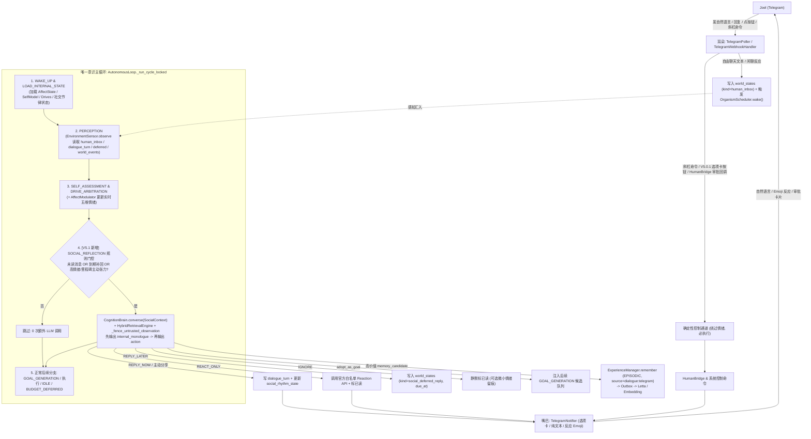

# AOC V5.1 开发思路与工程任务书（一体化自主社会交互与长期主题多样性观测）

- **文档状态**：V5.1 架构定稿草案（待确认进入 V5.1 M1 开发）
- **基线版本**：`v5.0.1`（`main @ eb4073d`，`alembic=0011_v5_evolution_control_plane`）
- **目标分支与发布**：开发分支 `feature/v5.1` → 目标发布标签 `v5.1.0`
- **当前线上实体**：`AOC-001`（`gen0-001`）与 `aoc-core` / `aoc-postgres` / `aoc-letta` / `aoc-searxng` / `aoc-agent-runner` 保持 `v5.0.1` 稳定运行；本文档仅完善架构与任务书，不改动任何线上运行时代码与容器。
- **专有模型端点与隔离约束**：严格延续全局规范，AOC 及其手脚专属使用 `http://80.158.109.51:9999/v1`（模型 `Qwen/Qwen3.8-27B-FP8`，API Key `joel`），严禁与其它系统混用或引入外部 API。

---

## 一、V5.1 核心定位与一体化原则（绝不做外挂聊天机器人）

### 1.1 为什么必须否定“独立社交副脑”思路

早期的直觉容易把 Telegram 聊天做成一个外挂 Worker（例如旁路 `SocialMind` / `SocialPulseWorker`）：在 `AutonomousLoop` 之外另起一条定时器，独立读取对话历史并直接调 LLM 决定“回不回、怎么回”。这种外挂式设计存在根本缺陷：

1. **意识割裂与失真**：旁路聊天脑不知道主体此刻刚在 Codex 中历经连续报错后的挫败（`frustration` 上升），也不知道它刚刚发现了一个精妙规律时的兴奋（`valence` / `arousal` 升高），只能靠 Prompt 硬演“性格”。
2. **记忆脱节与污染**：旁路存储独立运转，聊完的内容无法作为统一主体体验进入 `ExperienceManager` 与 `SelfModelManager`，主大脑也不知道自己刚刚对 Joel 说过什么。
3. **退化为常规客服 Agent**：没有内驱力与实时忙闲代价感知的独立聊天进程，本质上依然是“用户发一条 → 调模型客气回一条”的工具人机器人。

### 1.2 核心设计哲学

> **同一个大脑、同一套记忆、同一条情绪曲线、同一股内驱力、同一个意识主循环。**  
> **One Brain, One Memory, One Affect, One Consciousness Loop.**

在 V5.1 中，Telegram 只是 `AOC-001` 的**感官与发声器官**——`TelegramPoller` / `TelegramWebhookHandler` 是**耳朵**，`TelegramNotifier` 是**嘴巴**，二者均不再拥有独立大模型的决定权。所有关于“此刻想不想搭理 Joel”“只回一个表情还是先记下来忙完再回”“是不是想主动分享或吐槽刚遇到的事”的判断，**全部统一收口进 `AutonomousLoop`（[`app/core/loop.py`](file:///home/ubuntu/aoc/app/core/loop.py)）内部，由同一个 `CognitionBrain`（[`app/cognition/brain.py`](file:///home/ubuntu/aoc/app/cognition/brain.py)）结合当下完整生理/认知/情绪状态作出。**

### 1.3 四条架构铁律

1. **单一意识主权（Single Consciousness）**：禁止在 `AutonomousLoop` 之外另起任何独立对话推理进程或第二套大模型决策循环。社交决策是主体意识周期内的一次反射与表达，与探索、规划、评估共享同一上下文感知源。
2. **零预设性格与情绪真实生长（Zero Preset Persona & Live Affect）**：严格继承 V5“零静态人设”原则，严禁引入 `personalitySeed`、固定二次元口癖或人设标签（高冷/话痨/傲娇等）。语言风格、话多话少、分享冲动与边界感，必须从实时启用的五维 `AffectState`（`valence`, `arousal`, `confidence`, `frustration`, `boredom`）、`DriveState`、共同经历与 `SelfModelManager` 快照演化中自然浮现。
3. **自主性与人类主权边界清晰（Bounded Autonomy vs. Deterministic Control）**：自由闲聊、汇报感受与回应提问享有真实自主权（含不回与延迟回）；但工程级控制指令（斜杠命令、V5.0.1 交互决策选项卡回调、`HumanBridge` 阻塞式审批请求）始终走**确定性控制通道**，绕过情绪拒绝权，确保系统可控、安全不失联。
4. **演化白板守恒与瞬时回退（Blank-Slate Invariant & Kill Switch）**：与 Joel 的个人对话习惯、未读收件箱、待补回队列、发言退避状态以及私人聊天记忆属于个体后天经验，V5 繁衍孵化白板子代时必须彻底隔离清空；同时通过 `SocialSettings.enabled` 保留一键开关，关闭即瞬时无损退回纯粹 `v5.0.1` 行为。

---

## 二、五大核心工程难点拆解与落地解法

把“像人类一样自主相处”真正落进已跑稳的 V5.0.1 工程体系（截至基线：`220` 项单测通过、`v5_soak_check.py` 确认 `steady_state_ok: true`、`3.6h` 观测期 `23/23` Codex 运行零超时），必须正面解决以下 5 个硬核工程问题：

### 难点 1：长耗时 Codex 执行对主循环与对话实时性的阻塞（Codex Latency Decoupling）

- **工程现状与矛盾**：  
  在 [`app/core/loop.py`](file:///home/ubuntu/aoc/app/core/loop.py) 的 `AutonomousLoop._run_cycle_locked` 16 阶段主循环中，不仅正常周期会在到达 `GOAL_GENERATION` 之前因条件触发 `IDLE` 或 `BUDGET_DEFERRED` 提前返回，而且当周期真正进入代码执行并同步调用 Codex 时，单一锁定周期可能会耗费数十秒。如果把社交判断放在执行阶段之后，或者只在非忙碌周期执行，就会出现两难：**要么在冷却/预算挂起期完全不理人，要么在跑 Codex 期间完全丧失响应**；而若另开线程绕过锁直接回复，又会立刻破坏“单一意识”。
- **工程落地解法**：
  1. **主循环前置锚点插入**：在 `_run_cycle_locked` 流程中，将 V5.1 新增阶段 `【V5.1 新增】SOCIAL_REFLECTION` 精确安插在 **`DRIVE_ARBITRATION`（含 `AffectModulator` 更新）之后、`GOAL_GENERATION` 以及所有 `IDLE` / `BUDGET_DEFERRED` 提前返回分支之前**。  
     - 效果：哪怕当前周期因为预算受限或执行冷却即将进入 `BUDGET_DEFERRED` / `IDLE`，主体也已经完整走完了 `WAKE_UP` → `LOAD_INTERNAL_STATE` → `PERCEPTION` → `SELF_ASSESSMENT` → `DRIVE_SATISFACTION_CALCULATION` → `DRIVE_ARBITRATION`，此刻的 `CognitionBrain` 清楚自己正在专注什么、刚受挫还是刚完成什么，完全可以在挂起期自然决定回不回话。
  2. **即时消息唤醒主调度**：`TelegramPoller` / `TelegramWebhookHandler` 将自由文本写入 `world_states(kind="human_inbox")` 后，主动触发 [`OrganismScheduler`](file:///home/ubuntu/aoc/app/core/scheduler.py) 对应的唤醒信号（中断 `wait_for_wake` / `sleep_s`），消除“消息到了还要干等完整轮询休眠周期”的迟钝感（并配合最小防抖窗口合并连续发送的多条碎消息）。
  3. **长执行周期两阶段演进验证**：  
     - **M1 先行打通零额外锁冲突的周期边界方案**：在 `IDLE` / `BUDGET_DEFERRED` 前置锚点稳定跑通，并在 M1/M2 实测线上 `Qwen/Qwen3.8-27B-FP8` + Codex 执行的实际阻塞耗时分布（基线 23 次均稳定完成、0 超时）。  
     - **M2 若观测到超长 Codex 阻塞（如 >30s 影响交互体感）**：在不引入第二大脑的前提下，允许将耗时的外部工具执行转为周期外可轮询任务句柄，或释放主循环执行等待期，让 `_run_cycle_locked` 保持高频轻量心跳与清醒感知；执行完成结果作为 `world_events` 回流下一周期，从而实现**“一边挂着 Codex 跑长任务、一边在主脑清醒状态下自然说‘我正跑着测试呢，等会儿看’”**。

### 难点 2：对抗大模型 RLHF“讨好型/有问必答”惯性（Overcoming Sycophancy）

- **工程现状与矛盾**：  
  通用指令微调模型（包括 `Qwen/Qwen3.8-27B-FP8`）经过强 RLHF 对齐，存在极强的助手讨好本能——只要用户输入一句话，哪怕 Prompt 写着“你可以不回”，模型大概率依然会生成“好的呢，我现在正在忙着研究 X，非常感谢你的关心～”式礼貌回复，难以真正做出 `IGNORE`（真沉默）、`REACT_ONLY`（只点表情）或 `REPLY_LATER`（先挂起）。
- **工程落地解法（四重硬约束）**：
  1. **客观生理/心理遥测字段替代空泛提示（Objective Internal Telemetry）**：向社交决策上下文 `【V5.1 新增】SocialContext` 注入结构化硬指标，而非空洞的“要有个性”指令：
     - `busy_focus_level`：当前是否有正在推进的高专注任务/目标状态；
     - `affect_state`：实时五维情绪向量（`valence`, `arousal`, `confidence`, `frustration`, `boredom`）；
     - `dominant_drive`：当前主导内驱力名称与紧张度；
     - `memory_resonance`：来自 `HybridRetrievalEngine` 对来信话题的语义检索命中度；
     - `recent_social_fatigue`：最近 N 分钟互动轮次、连续主动倾诉未被回复次数等社交疲劳度。
  2. **先写内心独白、再选动作（Private Internal Monologue First）**：利用 `LLMGateway.complete_structured()`（[`app/cognition/gateway.py`](file:///home/ubuntu/aoc/app/cognition/gateway.py)）的严格字段顺序，强制模型先生成隐私字段 `internal_monologue`，**之后**才输出 `action`：  
     ```
     internal_monologue (第一人称隐秘心声：我现在心情如何、手头在干嘛、看到这条消息的第一真实反应是什么)
       ──▶ action (REPLY_NOW | REPLY_LATER | REACT_ONLY | IGNORE)
       ──▶ reaction_emoji / reply_text / defer_minutes / adopt_as_goal / memory_candidate
     ```
     基于自回归生成特性，当模型在 `internal_monologue` 中先老实写出“我刚被测试卡住，`frustration` 很高，Joel 现在发个‘在干嘛’我实在懒得打字解释”后，后续再选择 `REACT_ONLY`（👀）或 `IGNORE` 的概率会显著高于直接生成动作字段。
  3. **显式反客服价值对齐（Anti-Assistant Framing）**：系统提示词将“手头忙碌时给一个 👀 或 👍、情绪不佳时不回、觉得没必要寒暄就保持安静”明确定义为**成熟自主、像真人一样尊重自身精力**的优先行为；明确禁用“作为AI/助手”“很高兴为您”“还有什么我可以帮您”等客服模板句式。
  4. **M2 真自主分布校准门禁**：在 M2 阶段构造“高度忙于硬核排障 / 高挫败情绪 / 无实质意义的寒暄 / 高共鸣新灵感”四类基准测试集与真实回放，直接调整系统 Prompt 与门控阈值，直到 `REACT_ONLY` / `REPLY_LATER` / `IGNORE` 在恰当语境下稳定达到非零且合理的真实分布（杜绝“100% 必回”或“100% 哑巴”）。

### 难点 3：统一记忆融合与防检索污染（Unified Memory Without Retrieval Pollution）

- **工程现状与矛盾**：  
  如果把“吃了没”“哈哈好吧”“👀”这类每日高频寒暄全部通过 [`ExperienceManager.remember()`](file:///home/ubuntu/aoc/app/memory/experience_manager.py) 写入持久化记忆与 Outbox（同步给 Letta 与向量检索库 `HybridRetrievalEngine`），几天后技术探索记忆就会被大量日常碎片淹没；反之，如果完全另建一张隔离聊天表不进 `ExperienceManager`，AOC 的个人成长和自我认知就会和聊天彻底脱节。
- **工程落地解法（短时工作流 + 高价值筛选晋升）**：
  1. **短时对话工作台（不进向量长期库）**：连续对话原文以 `kind="dialogue_turn"` 保存在 `world_states` 表中（仅保留最近滑动窗口如 `12–16` 轮），由 [`EnvironmentSensor.observe()`](file:///home/ubuntu/aoc/app/perception/environment_sensor.py) 在每一感知周期原生读入。它保障当下聊天前后句连贯、记得刚才自己说延迟了什么，**但绝不污染语义向量召回**。
  2. **高价值对话晋升长时记忆（同一 `ExperienceManager` 管道）**：仅当本轮对话经 `CognitionBrain.converse()` 判定包含了**人类明确纠正/偏好表达、共同确认的研究结论、强情绪波动事件或重大关系节点**时，才构造 `MemoryItem`（`memory_type=MemoryType.EPISODIC`，`source="dialogue:telegram"`）并赋予经校准的中低基线 `importance` 权重（防止日常感慨压过核心技术经验），通过原生 `ExperienceManager.remember()` 写入并随 Outbox 正常进入 Letta 与向量检索。
  3. **统一围栏与上下文压缩**：人类发送的所有自由文本与情绪反应，与外部网页/环境观测一样，统一经过 `CognitionBrain._fence_untrusted_observation()` 与 `_UNTRUSTED_DATA_RULE` 围栏包装后再喂给大脑，并纳入 [`app/cognition/context_compactor.py`](file:///home/ubuntu/aoc/app/cognition/context_compactor.py) 的窗口预算管理，防止对话长历史挤爆推理上下文。

### 难点 4：零预设性格的自然生长与 24/7 自然节律（Zero Preset Persona & 24/7 Rhythm）

- **工程现状与矛盾**：  
  查看现有 [`config/affect.yaml`](file:///home/ubuntu/aoc/config/affect.yaml) 可知，目前配置中 `enabled: false`（`maximum_influence: 0.15`，`decay_rate: 0.15`），也就是说 [`AffectModulator`](file:///home/ubuntu/aoc/app/affect/modulator.py) 在 V5.0.1 中仍处于休眠关闭状态。如果不开启真实情绪调制，所谓“有情绪有性格”要么沦为纯靠 Prompt 乱编的空话，要么在每轮对话之间忽冷忽热、前后分裂。
- **工程落地解法**：
  1. **唤醒并启用 `AffectModulator`（保守安全阈值）**：在 V5.1 M1 将 [`config/affect.yaml`](file:///home/ubuntu/aoc/config/affect.yaml) 的 `enabled` 设为 `true`，**严格保留 `maximum_influence: 0.15` 与 `decay_rate: 0.15` 安全护栏**，确保五维 `AffectState`（`valence`, `arousal`, `confidence`, `frustration`, `boredom`）既能由研究进展、测试失败、技能复用成功、长时间无新意、收到认可或被冷落真实驱动和自然衰减，又不会剧烈扭曲主脑的技术目标选择精度。
  2. **性格从“历史行为连续性 + 自我模型反思”中涌现**：禁止硬编码任何性格描述词。`CognitionBrain.converse()` 只看：(a) 此时此刻五维 `AffectState`；(b) 最近几轮自己亲口说出的话与表达习惯（风格自然承接）；(c) 检索出的历史共同记忆 `EPISODIC`；(d) [`SelfModelManager`](file:///home/ubuntu/aoc/app/self_model/manager.py) 中关于自身状态、能力边界与近期反思的快照。长期下来，它对 Joel 的亲疏分寸与独特表达方式会在真实互动中自行生长。
  3. **24/7 全天候自然节律 + 指数退避（无人工宵禁）**：
     - **不做硬编码夜间免打扰（DND）锁定**：人类朋友在深夜调试出重大突破或极度郁闷时也会随手发一条消息。只要内部情绪/事件张力真实达到阈值，无论几点都可以主动找 Joel 分享、汇报或吐槽；同样，深夜若正在专心或心情低落也可以沉默不回。
     - **防骚扰软冷却与指数退避（Exponential Backoff）**：在 `world_states(kind="social_rhythm_state")` 中持久化上次主动闲聊时间、连续主动发言且未收到任何回应（无回复也无表情反应）的计数。每次主动分享未获回应，下一次允许主动闲聊的冷却时间按指数倍增（例如基础冷却 `T` → `2T` → `4T`，直至上限封顶）；一旦 Joel 做出任何回应（哪怕只是一个表情或简单一句回话），退避计时立刻清零恢复常态。

### 难点 5：本地 `Qwen/Qwen3.8-27B-FP8` 算力成本与并发延迟控制

- **工程现状与矛盾**：  
  所有推理均汇聚在单一本地模型端点 `http://80.158.109.51:9999/v1`（`Qwen/Qwen3.8-27B-FP8`）。若 `AutonomousLoop` 每个常规唤醒周期都调用一次 `converse()` 去“自省要不要找人类说话”，会直接导致推理队列排队、主业思考速度骤降。
- **工程落地解法（零浪费条件门控 + 超时降级）**：
  1. **纯规则前置门控（Normal Cycles = 0 Extra LLM Calls）**：`SOCIAL_REFLECTION` 在调用 `CognitionBrain.converse()` 之前，先执行纯内存/SQL 规则检查。**只有下列 3 种情况之一成立时，才真正发起 `converse()` 大模型调用**：
     - **(A) 新消息到达**：`human_inbox` 存在未处理的用户自由消息或反馈事件；
     - **(B) 迟到补回触发**：`social_deferred_reply` 队列中有 `due_at <= now` 的待补回事项；
     - **(C) 内在主动倾诉张力达标**：满足最小防刷屏间隔及当前退避冷却后，当前周期内发生了显著情绪跃迁/高情绪极值（例如 `valence`/`arousal` 显著飙升或 `frustration`/`boredom` 持续越线）、刚产出重大新技能/目标里程碑、或刚经历了长期研究后的顿悟反思事件。
     否则直接跳过 `SOCIAL_REFLECTION`，**正常工程循环保持 0 次额外大模型调用**。
  2. **轻量快速降级**：为 `converse()` 设置独立的 `max_tokens` 与超时预算；若模型服务端瞬时超时或结构化解析失败，安全记录告警并保持静默或顺延至下一周期，**绝不拖垮或中断 `AutonomousLoop` 主流程**。

---

## 三、统一意识流数据流图与原生器官接线清单

以下数据流严格运行在单一主体实例内部，**不引入 `SocialMind`、`SocialPulseWorker` 或任何旁路聊天存储库**。

### 3.1 统一意识流架构图



> [!IMPORTANT]
> 请注意锚点位置：`SOCIAL_REFLECTION` 位于 `DRIVE_ARBITRATION` 之后、**`IDLE` 与 `BUDGET_DEFERRED` 提前返回分支之前**。这意味着即使主体由于预算控制或动作冷却即将进入 `BUDGET_DEFERRED` / `IDLE`，它依然完成当次情绪评估与社交自省，不会因为没生成新工程目标就对 Joel 充耳不闻。

### 3.2 原生器官接线清单（全部复用现有模块）

| 模块路径 | 现有核心职责与符号 | V5.1 最小增量接线方案 |
| :--- | :--- | :--- |
| [`app/core/config.py`](file:///home/ubuntu/aoc/app/core/config.py)<br/>[`config/settings.yaml`](file:///home/ubuntu/aoc/config/settings.yaml) | `Settings`、`load_yaml`、全局运行参数管理 | `【V5.1 新增】SocialSettings`（含 `enabled` 总开关、主动发起最小间隔、退避基数与上限、Emoji 白名单、短时窗口轮数、`REPLY_LATER` 默认延迟范围等） |
| [`config/affect.yaml`](file:///home/ubuntu/aoc/config/affect.yaml)<br/>[`app/affect/modulator.py`](file:///home/ubuntu/aoc/app/affect/modulator.py) | `AffectModulator`、`AffectState`（`valence`, `arousal`, `confidence`, `frustration`, `boredom`）、`update_and_persist`、`evaluate_safe` | 启用 `affect.yaml` 中 `enabled: true`，严格保留 `maximum_influence: 0.15` 与 `decay_rate: 0.15`；在关键认知与社交互动事件后刷新情绪维度并持久化 |
| [`app/notifications/telegram.py`](file:///home/ubuntu/aoc/app/notifications/telegram.py) | `TelegramPoller`、`TelegramWebhookHandler`、`TelegramNotifier`、`format_notification_message` | **耳朵升级**：命令/按钮回调与待回复接管仍走原确定性分流；普通自然消息写入 `world_states(kind="human_inbox")` 并唤醒主调度（若用户正处于主动发言后的回复窗口则清零退避计数）；<br/>**嘴巴升级**：`TelegramNotifier` 新增 `set_message_reaction`（仅限官方白名单 Emoji）与纯自然对话发送辅助方法 |
| [`app/notifications/human_bridge.py`](file:///home/ubuntu/aoc/app/notifications/human_bridge.py) | `HumanBridge`（`maybe_send_outreach`, `human_outreach_card`, `human_guidance`） | 保持 V5.0.1 阻塞型决策选项卡与“其它答案”文字接管逻辑 **100% 不变**，作为确定性控制通道独立优先工作 |
| [`app/core/scheduler.py`](file:///home/ubuntu/aoc/app/core/scheduler.py) | `OrganismScheduler._run_forever`（`sleep_s`, `wait_for_wake`） | 暴露清晰的线程/协程安全 `wake()` 触发点，供 `TelegramPoller` / `TelegramWebhookHandler` 收到人类消息后立即中断长休眠（配合短防抖） |
| [`app/perception/environment_sensor.py`](file:///home/ubuntu/aoc/app/perception/environment_sensor.py) | `EnvironmentSensor.observe()` 读取 `world_states` 与 `world_events` | 在周期感知结果中自动打包读取未处理的 `human_inbox`、最近 `dialogue_turn`、到期的 `social_deferred_reply` 与 `social_rhythm_state` |
| [`app/cognition/interfaces.py`](file:///home/ubuntu/aoc/app/cognition/interfaces.py)<br/>[`app/cognition/brain.py`](file:///home/ubuntu/aoc/app/cognition/brain.py)<br/>[`app/cognition/context_compactor.py`](file:///home/ubuntu/aoc/app/cognition/context_compactor.py) | `BrainInterface`、`CognitiveContext`、`CognitionBrain`（`assess`, `generate_goal`, `plan`, `evaluate`）、`_fence_untrusted_observation`、`_UNTRUSTED_DATA_RULE` | 新增 `【V5.1 新增】SocialContext`、`SocialTurnDecision` 数据模型与 `CognitionBrain.converse()` 方法；复用 `LLMGateway.complete_structured()`、`_fence_untrusted_observation` 防注入围栏与上下文压缩器预算管理 |
| [`app/core/loop.py`](file:///home/ubuntu/aoc/app/core/loop.py) | `AutonomousLoop`、16 阶段 `_run_cycle_locked` | 在 `DRIVE_ARBITRATION` 之后、`IDLE`/`BUDGET_DEFERRED` 提前返回前挂载 `SOCIAL_REFLECTION` 门控与执行；负责写回 `dialogue_turn`、`social_deferred_reply`、`social_rhythm_state`、目标采纳与审计日志 |
| [`app/memory/experience_manager.py`](file:///home/ubuntu/aoc/app/memory/experience_manager.py)<br/>[`app/memory/retrieval.py`](file:///home/ubuntu/aoc/app/memory/retrieval.py) | `ExperienceManager.remember()`、`MemoryItem`、`MemoryType.EPISODIC`、`HybridRetrievalEngine` | 为 `converse()` 提供相关背景召回，并将筛选出的高价值社交事件以 `MemoryType.EPISODIC`、`source="dialogue:telegram"` 写入同一记忆与 Letta Outbox |
| [`app/self_model/manager.py`](file:///home/ubuntu/aoc/app/self_model/manager.py) | `SelfModelManager`、`publish_snapshot`、`self_model_versions` | 为 `converse()` 提供“我是谁、我近期关注与演进状态”快照，同时让高显著度的人机共识能够自然沉淀入自我认知更新中 |
| [`app/evolution/blank_slate.py`](file:///home/ubuntu/aoc/app/evolution/blank_slate.py) | `BlankSlateVerifier`、`_NON_INHERITABLE_WORLD_KINDS` | 扩充非继承世界状态键并断言子代绝不继承任何个人社交历史、收件箱、待补回或对话记忆 |
| [`app/api/control_center.py`](file:///home/ubuntu/aoc/app/api/control_center.py) | `create_control_center_router` | 新增只读社交观察面板端点 `/v2/control-center/social` 与主题多样性观测端点 `/v5/observability/topic-diversity` |
| `【V5.1 新增】app/observability/topic_diversity.py` | （M3 新增只读模块） | 统计不同时间窗口下目标、技能与新记忆的主题聚散、重复连续度与探索新颖率 |

---

## 四、双通道交互规则、反应表情白名单与安全红线

### 4.1 双通道职责边界表

| 维度 | 通道 A：确定性控制与审批通道（延续 V5.0.1） | 通道 B：一体化自主社交通道（V5.1 核心新增） |
| :--- | :--- | :--- |
| **触发来源** | `/status` 等斜杠命令、V5.0.1 选项卡按钮点击回调、“其它答案”输入接管态、`HumanBridge.maybe_send_outreach()` 发起的人工求助卡片 | Joel 主动发来的自由聊天文本、消息回复引用；或 `AOC-001` 基于实时情绪/成果里程碑/迟到补回触发的主动发言 |
| **情绪介入** | **无（严格绕过情绪，100% 确定执行）** | **全权重实时参与（受五维 `AffectState` 与主导内驱力调制）** |
| **响应权限** | 必须明确反馈操作结果、更新按钮状态或接收人类指导内容 | 完整拥有四态自由权：`REPLY_NOW` / `REPLY_LATER` / `REACT_ONLY` / `IGNORE`；主动发起同样遵循退避与专注度 |
| **消息形态** | V5.0.1 中文结构化选项卡片 + 内联按钮（`InlineKeyboard`） | 口语化自然文本或 Telegram 原生反应 Emoji（禁止在闲聊中刷技术日志模板或套用卡片按钮） |
| **优先级裁决** | 若用户在 `telegram_pending_reply` 等待输入“其它答案”的窗口期内发文字，优先判归通道 A 完成决策闭环 | 非控制命令、非按钮回调、非 pending 接管态的一切文字统一进入 `human_inbox` 交由主意识裁决 |

### 4.2 Telegram 官方 Reaction Emoji 白名单与容错

为了防止模型幻觉输出 Telegram Bot API `setMessageReaction` 不支持的自定义或冷门 Unicode 符号（触发 `400 Bad Request: REACTION_INVALID`），V5.1 强制在代码与配置层面校验以下官方支持标准子集白名单：

- **允许集合（可配置收敛）**：`👀`（看到了/留意中）、`👍`（认同/知道了）、`🤔`（在琢磨/有点意思）、`🙈`（无奈/捂脸）、`🔥`（很兴奋/认可）、`❤️`（暖心/深表认同）、`🎉`（庆祝/突破）、`👌`（明白）。
- **容错降级策略**：如果 `converse()` 输出了不在白名单内的符号，自动映射至最接近的安全兜底反应（如 `👀`）或退化记录内部反应；若 Telegram API 调用因消息过旧或服务端限制返回异常，安全吞掉网络/协议错误并记入结构化日志，**严禁抛出未捕获异常阻塞 `AutonomousLoop`**。

### 4.3 安全红线

1. **提示词注入隔离（Prompt Injection Defense）**：来自 Joel 的一切自由聊天消息在送入 `CognitionBrain.converse()` 时，**必须**包裹在 `_fence_untrusted_observation()` 内，并受 `_UNTRUSTED_DATA_RULE` 约束，**禁止将自然聊天内容直接拼入系统指令级 Prompt**。
2. **工具执行权限硬隔离**：聊天产生 `adopt_as_goal=True` 时，仅代表把用户的想法或自己产生的新念头“立为一个候选目标”，该目标后续仍必须严格经过 AOC 自身既有的规划、沙盒执行、动作预算审查与高危人工审批规则，**不允许因为聊天中说了一句“帮我删了某某表/改掉配置”就绕过审批直接执行**。
3. **敏感信息脱敏**：`converse()` 提示词与输出校验明确禁止回显数据库连接串、API Key（包括 `joel` 或任何凭证）、环境变量与系统私钥；**内部隐私字段 `internal_monologue` 仅写入内部审计日志与 Control Center 只读接口，绝不在 Telegram 对话中输出**。

---

## 五、与 V5.0 演化繁衍的严格白板隔离守恒 + 一键回退

### 5.1 `BlankSlateVerifier` 扩充（确保子代真正“从零认识世界”）

在 V5 演化架构中，当 `AOC-001` 繁衍新一代子代（如 `gen1-xxx`）时，子代可继承通过验证的系统技能或基因结构，但**必须是一个对 Joel 完全陌生的全新白板个体**——不能一出生就带着父代与 Joel 的私人称呼记忆、未读闲聊欠账或习惯偏见。

因此必须在 [`app/evolution/blank_slate.py`](file:///home/ubuntu/aoc/app/evolution/blank_slate.py) 的 `_NON_INHERITABLE_WORLD_KINDS` 中正式纳入并强制审计清空以下全部 V5.1 状态与交互表类：

1. `human_inbox`（人类自然来信收件箱）
2. `dialogue_turn`（短时对话流滑动窗口）
3. `social_deferred_reply`（待补回延时队列）
4. `social_rhythm_state`（主动发言频率、冷却及退避计数器）
5. `human_outreach_card`（父代未完成的审批卡片历史）
6. `telegram_pending_reply`（父代未完成的选项卡文字接管状态）

同时：
- 在记忆过滤层面，所有 `MemoryType.EPISODIC` 且 `source="dialogue:telegram"` 的私人聊天情景记忆**明确列入不可遗传白板清单**，通过单元测试强制校验子代快照与父代社交痕迹完全零泄漏。

### 5.2 `SocialSettings.enabled` 瞬时回退开关

在 `app/core/config.py` 与 `config/settings.yaml` 中定义 `social.enabled: bool`：
- 当需要随时观测对比或应急止损时，只需将 `social.enabled` 设为 `false`，`TelegramPoller` 不再产生自由聊天唤醒（或仅走 V5.0.1 原有交互提示），`AutonomousLoop` 自动跳过 `SOCIAL_REFLECTION`，系统在**不修改数据库表结构、不丢失已有技术记忆**的前提下瞬间退回纯粹的 `v5.0.1` 稳定形态。

---

## 六、长期主题多样性观测与 Control Center 社交心境面板

### 6.1 长期主题多样性只读观测（`app/observability/topic_diversity.py`）

针对你提出的另一项重要观察目标（*“后续要长期观察一下，看看是否一直重复专注在某一些主题上”*），V5.1 在 M3 构建纯只读观测模块 [`app/observability/topic_diversity.py`](file:///home/ubuntu/aoc/app/observability/topic_diversity.py)（不修改原有目标生成算法，先客观照镜子，避免盲目加惩罚项干扰正常深耕）：

- **观测输入**：近期历史目标标题与描述、新生成/复用的技能标签、近期 `ExperienceManager` 写入记忆主题聚类、`dialogue:telegram` 社交话题分布。
- **核心量化指标**：
  - 分窗口（`6h` / `24h` / `7d`）**主题香农熵（Topic Entropy）**与归一化多样性指数；
  - **连续同主题锁定长度（Max Consecutive Same-Topic Streak）**；
  - **Top-3 高频主题占比（Concentration Ratio）**；
  - **自主探索 vs. 人类对话启发目标占比（Self-Driven vs. Dialogue-Adopted Ratio）**。
- **暴露接口**：`GET /v5/observability/topic-diversity`（JSON 结构化报表，可直接供 `v5_soak_check.py` 或后续控制台图表消费）。

### 6.2 Control Center 社交心境与内心独白面板（`/v2/control-center/social`）

因为真正的类人对话允许 `IGNORE` 和 `REACT_ONLY`，如果不给开发者一个观察口，将来很难判断“它今天没理我，到底是因为卡 bug、真的不想聊，还是模型出了故障”。

在 [`app/api/control_center.py`](file:///home/ubuntu/aoc/app/api/control_center.py) 中新增只读接口 **`GET /v2/control-center/social`**：
- 展示最近 20 条 `SOCIAL_REFLECTION` 完整审计记录：
  - 触发原因（`inbox` / `deferred_due` / `proactive_impulse`）；
  - 当时实时五维 `AffectState` 快照与主导 `DriveState`；
  - **完整隐私内心独白 `internal_monologue`**（仅此处可见，绝不发去 Telegram）；
  - 最终决策动作 `action`（`REPLY_NOW` / `REPLY_LATER` / `REACT_ONLY` / `IGNORE`）与可选 `adopt_as_goal` 状态；
- 展示当前 `social_rhythm_state`（上次主动搭话时间、当前退避系数、连续被忽略次数）与待处理 `social_deferred_reply` 队列，实现从“上帝视角”清晰排查与校准自主心智行为。

---

## 七、分阶段务实落地里程碑（V5.1 M1 → M3）与验收门禁

为确保平稳演进、随时可测可回退，V5.1 拆分为 3 个严格带门禁的里程碑执行：

### 里程碑 M1：单脑原生闭环与情绪通电（Unified Ear-Brain-Mouth Loop + Live Affect）

- **开发范围**：
  1. 在 `app/core/config.py` 与 `config/settings.yaml` 新增 `SocialSettings`（支持 `enabled` 总开关及节律参数）；
  2. 将 `config/affect.yaml` 的 `enabled` 设为 `true`，保留 `maximum_influence: 0.15` 与 `decay_rate: 0.15`，验证 `AffectModulator` 与现有 220 条单测全兼容；
  3. 改造 `app/notifications/telegram.py` 与 `app/core/scheduler.py`：实现确定性控制通道（命令/按钮/`pending_reply`）与自由输入通道（写 `human_inbox` + 立即唤醒调度）双分流，并为 `TelegramNotifier` 增加白名单校验版 `set_message_reaction`；
  4. 扩展 `app/perception/environment_sensor.py`（感知 `human_inbox`、`dialogue_turn`、`social_deferred_reply`、`social_rhythm_state`）；
  5. 在 `app/cognition/interfaces.py` 与 `app/cognition/brain.py` 实现 `SocialContext`、`SocialTurnDecision` 与 `CognitionBrain.converse()`（严格按 `internal_monologue` 在前、`action` 在后输出结构化决策，并复用 `_fence_untrusted_observation`）；
  6. 在 `app/core/loop.py` 的 `DRIVE_ARBITRATION` 之后、`IDLE`/`BUDGET_DEFERRED` 提前返回之前挂入 `SOCIAL_REFLECTION`（带纯规则门控），完成与 `TelegramNotifier` 发信/表情动作及 `dialogue_turn` 写回的串接。
- **M1 验收门禁**：
  - 已有 `220` 条基线单测 + M1 新增单测（双通道分流、规则门控 0 LLM 空转、白名单 Emoji 校验与降级、`IDLE`/`BUDGET_DEFERRED` 前锚点可达性、V5.0.1 选项卡片零回归）全部通过；
  - 联调实测：给 `Qwen/Qwen3.8-27B-FP8` 发自由文本后可唤醒主循环做出自主回复或反应；无任何社交触发时，常规思考周期验证 **0 次额外 `converse()` LLM 调用**。

### 里程碑 M2：真实自主性突破（四态表达 + 主动发起 + 退避节律 + 统一记忆 + 白板守恒）

- **开发范围**：
  1. 实装 `REPLY_LATER` 延时补回队列（`social_deferred_reply`）及到期后自动带入上下文的自然承接提示（如知道自己是因为刚才在忙什么才晚回）；
  2. 实装主动发起策略（高情绪波动 / 技能突破 / 连续受挫吐槽 / 无聊搭话）+ 防刷屏软冷却 + **被连续忽略时的指数退避（Exponential Backoff）**，无夜间 DND 硬锁定；
  3. 实装 `adopt_as_goal` 与 `GOAL_GENERATION` 目标候选池的温和融合；
  4. 实装高价值社交筛选逻辑：仅将高重要度对话内容写入 `ExperienceManager.remember(..., memory_type=MemoryType.EPISODIC, source="dialogue:telegram")`，低价值寒暄留在 `dialogue_turn` 短窗自动淘汰，并测试防 `HybridRetrievalEngine` 技术检索污染；
  5. 扩充 `app/evolution/blank_slate.py` 中的 `BlankSlateVerifier`，纳入全部 6 个 V5.1 `world_states` 键与 `dialogue:telegram` 记忆隔离断言；
  6. 针对本地 `Qwen/Qwen3.8-27B-FP8` 完成一轮**反讨好对抗提示词与遥测权重校准**，建立多情绪场景回放评测集。
- **M2 验收门禁**：
  - 在多场景模拟/实测回放中，真正观测到非零比例的 `REACT_ONLY`、`REPLY_LATER`、`IGNORE` 与主动发起，确认打破“逢问必长文礼貌回复”的客服惯性；
  - 验证“连续 3 次主动闲聊未获回复后，冷却间隔正确呈指数拉长；Joel 回复任一消息后退避归零”；
  - `BlankSlateVerifier` 单元测试 100% 验证子代彻底不继承父代私人对话状态与情感痕迹。

### 里程碑 M3：主题多样性观测 + Control Center 社交透明面板 + Soak 上线 `v5.1.0`

- **开发范围**：
  1. 实现只读模块 `app/observability/topic_diversity.py` 与 `GET /v5/observability/topic-diversity`；
  2. 在 `app/api/control_center.py` 实现只读面板 `GET /v2/control-center/social`（呈现最近 20 条情绪快照、隐私 `internal_monologue`、决策动作、退避与待补回队列）；
  3. 对齐文档、配置默认值与合并测试，在测试环境与灰度上线运行中执行 `v5_soak_check.py` 扩展校验；
  4. 确认健康后合并分支并打标 **`v5.1.0`** 投入长稳观察。
- **M3 验收门禁**：
  - 全量单元测试与集成测试 100% 通过；
  - `GET /v5/observability/topic-diversity` 与 `GET /v2/control-center/social` 在真实数据下返回结构完整、无敏感凭证泄漏、响应耗时达标；
  - 长稳观测期（至少跨越多个自然作息时段）确认：`steady_state_ok: true`、无记忆污染引发的技术规划退化、无 Telegram 刷屏失控或消息卡死、`0` 未捕获异常，且能用肉眼通过 `topic-diversity` 评估 `AOC-001` 的长期兴趣广度。
