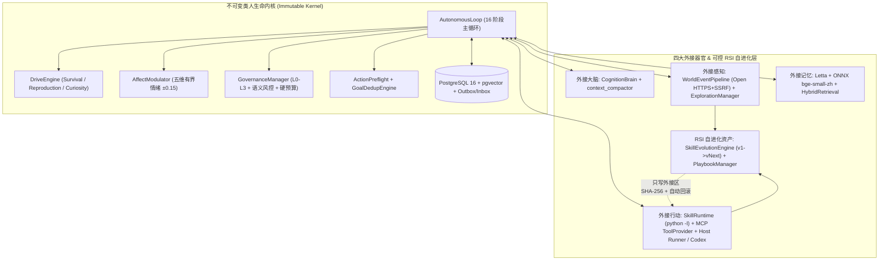

# Artificial Organism Core (AOC) — 系统架构设计（V4.0）

## 1. 整体架构概览

AOC 采用 Python 3.12+ **模块化单体（Modular Monolith）** 架构，通过显式抽象契约（`interfaces.py` / `base.py`）和 Pydantic v2 Schema 解耦模块依赖。从 V3.2 到 V4.0，系统确立了清晰的**数字生命体双层架构**：

1. **不可变类人生命内核（Immutable Kernel — 人类独占权限）**：`app/core/`、`app/drives/`、`app/affect/`、`app/governance/`、`app/storage/`，负责生命周期状态机、三大独立内驱力公式、有界五维情绪调制、L0–L3 安全审批与每日硬预算上限，以及 PostgreSQL + 事务 Outbox/Inbox 持久化真相源。
2. **四大可插拔外接器官与可控 RSI 自进化区（Pluggable Organs & Self-Evolution Zone）**：外接大脑（LLM + 分层上下文压缩）、外接感知（RSS/Git/Web/System + SSRF 防护与外部探索管理）、外接记忆（Letta + 本地 ONNX Embedding + `pgvector`）、外接行动（Host Runner / `codex-cli` / 隔离 `SkillRuntime` / MCP ToolProvider），以及运行在内核之外的外置 `Skill Packages` 与 `External Playbooks` 自我进化层。

---

## 2. 模块边界与职责清单

| 模块域 | 路径 | 核心组件与职责 | 显式契约 |
|---|---|---|---|
| **Core Runtime** | `app/core/` | 只读配置与环境变量加载 (`config.py`)、枚举 (`LifecycleState` 含 `THROTTLED` / `QuotaStatus`)、9 态生命周期管理、带配额退避的 `OrganismScheduler`、16 阶段 `AutonomousLoop` (防重入锁)、`OrganismRuntime` 装配 | 仅通过各模块接口协同，不越权直写外接内部实现 |
| **Perception** | `app/perception/`, `app/perception/world/` | `SensorManager`、`SystemSensor` (复用 `LLMGateway.health_check`)、`AgentSensor`、`EnvironmentSensor`、`WorldEventPipeline` (RSS/Git/Web + `open_public_https` 可控扩源 + SSRF/DNS 重绑定拦截)、`ExplorationManager` (防内部自检死循环) | `PerceptionInterface`, `SensorInterface`, `Observation` |
| **Drive Engine** | `app/drives/` | `SurvivalDriveEvaluator` (健康/资源/依赖与经济配额正交解耦)、`ReproductionDriveEvaluator` (仅计实证能力与 SHA-256 `VALIDATED` Skill)、`CuriosityDriveEvaluator` (知识空白+实测 IG)、`arbitrate()` 混合仲裁 | `DriveEngineInterface`, `DriveEvaluator`, `DriveState`, `DriveDecision` |
| **Affect** | `app/affect/` | 有界五维情绪状态 (`valence`, `arousal`, `confidence`, `frustration`, `boredom`) 持久化与衰减调制，只读注入 Brain 并有限调节仲裁、反思频率与重试退避 | `AffectModulator`, `AffectState`, `AffectModulation` |
| **Cognition** | `app/cognition/` | 统一 `LLMGateway` (周期/日预算/并发/熔断器/外部 Codex 记账)、`CognitionBrain` (`assess` / `generate_goal` / `plan` / `evaluate`)、`ActionPreflight` 编译期预检、`GoalDedupEngine` 与多候选效用排序、`context_compactor.py` 三层压缩器 | `BrainInterface`, `LLMGatewayInterface`, `CognitiveContext`, `ActionPlan` |
| **Governance** | `app/governance/` | L0–L3 分级规则、双语 `SemanticRiskClassifier` (超时 Fail-Closed 至 L2)、强绑定 `ApprovalService`、单任务隔离工作区与每日硬预算 | `GovernanceInterface`, `PolicyVerdict`, `BudgetStatus` |
| **Orchestration & Agents** | `app/orchestration/`, `app/agents/`, `app/runner/` | 16 态乐观锁 `TaskStateMachine`、纯 DB 幂等 `TaskFinalizer`、`ResultVerifier`、`AgentRegistry`、`AgentRouter`、`CodexAdapter` (`0.171.0`)、宿主机 `systemd` Runner (`/run/aoc-runner/runner.sock`, cgroup v2, `ProcessIdentity`) | `AgentInterface`, `ExecutionBackendInterface`, `AgentExecution` |
| **Skills & RSI (V4 进化区)** | `app/self_model/`, `app/skills/` | Beta-Binomial `SelfModelManager`、隔离测试 + SHA-256 `SkillRegistryManager`、`SkillRuntime` (`python -I` + Input/Output Schema 校验)、`SkillEvolutionEngine` (规范命名/语义去重/`v1->vNext` Gate A/B 与自动回滚)、`PlaybookManager` (`<ws>/playbooks/<domain>/v<N>.md` + 退化自动回滚) | `SelfModelInterface`, `SkillRegistryInterface`, `SkillExecutionResult` |
| **MCP Tools** | `app/tools/` | `MCPClientManager` (stdio JSON-RPC 2.0) 管理 3 个内置原子工具与动态自动同步的 `skill:<canonical_name>` 工具 | `ToolProviderInterface`, `ToolSpec`, `ToolCallRequest` |
| **Memory** | `app/memory/` | `ExperienceManager`、可热切换 ONNX Embedding (`bge-small-zh-v1.5` 512d)、`HybridRetrievalEngine`、`InformationGainEvaluator`、`LettaAdapter` | `MemoryInterface`, `EmbeddingInterface`, `MemoryItem` |
| **Storage** | `app/storage/` | Async SQLAlchemy 2.x、Alembic `0001`–`0010`（含 `skill_registry` V4 扩展列与 `skill_invocations`，复用 `digital_world_state` 承载 `hypothesis` / `exploration_topic` / `external_playbook`）、PostgreSQL `SKIP LOCKED` 事务 Outbox/Inbox、`StateRepository` | `StateRepository`, `OutboxDispatcher` |
| **API & Control Center** | `app/api/`, `frontend/` | FastAPI HTTP 服务、Bearer Token + 4 级 RBAC (`auth.py`)、`/v2/control-center/*` 13 个只读可观测接口 (`control_center.py`)、React+Vite Control Center（含拟人生命解剖总览与 V4 RSI 进化看板）、Prometheus `/metrics` | HTTP JSON + Prometheus |

---

## 3. 核心架构不变量（Hard Invariants）

1. **禁止 LLM 直接篡改驱动力**：`satisfaction` 只能基于真实事后感知与确定性/有界公式重算；Expected、Actual 与 Measured Satisfaction Change 严格分离持久化。
2. **缺失指标绝不伪装健康**：感知器无法采集时明确标记 `{"status": "unavailable", "reason": ...}` 并降低置信度，触发保守策略。
3. **Brain 严格无副作用特权**：`CognitionBrain` 不持有数据库 Session、策略改写接口、审批权或执行器句柄，仅返回受 Pydantic 校验的建议结构体。
4. **不可变内核 vs 外接 RSI 硬边界（V4.0）**：所有自进化脚本与 Playbook 静态扫描均明确拦截对 `app/core/`、`app/drives/`、`app/affect/`、`app/governance/`、`app/storage/` 的修改以及 L3 权限、危险 Shell/SQL 与动态 `eval`/`exec`。
5. **异步解耦执行与隔离工作区**：外部 Agent 任务落盘于 `<workspace_root>/<task_id>`（L0 `read-only` / L1 `workspace-write`），由宿主机非特权 `systemd` Runner (`aoc-agent-runner.service`, `User=ubuntu`, `cgroup v2`) 执行并以 `ProcessIdentity` (`boot_id + /proc/<pid>/stat starttime`) 实现 `kill -9` 零孤儿对账。
6. **经济配额与生存危机正交解耦**：日常预算耗尽仅进入 `THROTTLED` 休眠等待 `quota_reset_at`，绝不误触发 `Survival CRITICAL` 空转。
7. **纯数据库重构的单一幂等终态收敛**：`TaskFinalizer.finalize_execution()` 通过 `inbox_events` + 悲观/状态机校验保证同周期、跨周期 `IN_FLIGHT`、审批后执行及 Outbox 10 次重放严格幂等。
8. **L2 强绑定审批与 Fail-Closed 语义风控**：三层风控取最严格等级 `max(requested, deterministic_bilingual, semantic_llm)`，语义风控超时或异常自动 Fail-Closed 为 L2；审批记录强绑定 `(task_id, plan_hash, params_digest, nonce, expires_at)`。
9. **外接工具与通用 Agent 契约分离，SkillRuntime 为高速执行路径**：严格区分通用自主 Agent（当前主力 `codex-cli 0.171.0`，`hermes` 维持禁用）、MCP `ToolProvider` 与 `SkillRuntime`（仅执行 SHA-256 完好且测试通过的 `VALIDATED` Skill）。
10. **无静态能力泄露的实证 Self Model**：外部 Agent 静态宣称能力仅停留于 `DECLARED`/`AVAILABLE`，对 `Reproduction` 覆盖度贡献恒为 `0`；能力晋升需满足 `capability_evidence` 驱动的 Beta-Binomial 后验或有效 Skill 实证。
11. **确定性薄内核防死循环护栏（V3.0–V3.1）**：发射前 `ActionPreflight`（Fail-Closed 阻断 L0 写入冲突、路径穿越与短时重复方案）；`GoalDedupEngine` 结合结构指纹、词法/语义相似度、冷却退避与多候选效用排序遏制重复无效目标。
12. **可信围栏与 SSRF 零妥协（V2.0–V4.0）**：无论严苛白名单模式还是 V4 公开 HTTPS 动态感知模式（`open_public_https=True`），均强制在 DNS 解析阶段拦截回环、`RFC1918` 私网、`169.254.169.254` 云元数据、IPv6 内网、`localhost`/`.internal`、裸 IP 与非 HTTPS；Prompt Injection 自动检疫隔离；`context_compactor` 在截断时亦保证 `<untrusted_world_event>` 闭合标签 100% 完整。
13. **验证即事实，失败自动回滚（V4.0）**：`SkillEvolutionEngine` 必须同时通过 Gate A（父版回归）与 Gate B（新版边界）及客观改进/延迟检查才可晋升；`PlaybookManager` 追踪实证结果，新版本表现退化且样本 ≥ 3 时自动回滚至 `parent_version`；确定性校验失败时强制剥离 `goal_achieved`、`confirmed` 假设及 `playbook_update`。
14. **有界情绪调制边界**：`AffectModulator` 影响严格限定在受控边界（`±maximum_influence ≤ 0.15`）且永不触碰 `Survival CRITICAL`、L0–L3 安全策略、审批及硬预算；发生异常静默降级为中性无调制策略。
