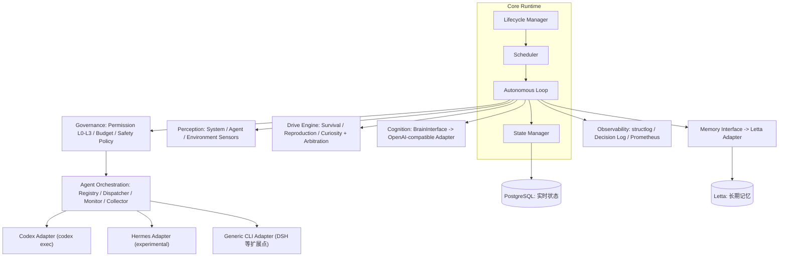

# AOC V1.0 实施计划（架构设计 + 技术风险清单）

> 依据：上传的《AOC V1.0 最小自主生命核心开发任务书》全文（1203 行）。
> 按任务书第十七章开发纪律：**先提交架构设计和技术风险清单，确认后再按 P0-1 → P0-8 顺序开发**。

---

## 1. 本机环境调研结论（影响架构决策）

| 项目 | 现状 | 对 AOC 的影响 |
|---|---|---|
| Python | 系统 3.10；`uv 0.13.5` 可用（Hermes 自带） | 用 `uv` 拉取 **Python 3.12** 建独立 venv，满足 3.12+ |
| Docker / Compose | **未安装** | 任务书要求 Compose 部署 → 需安装（需 root，沙箱外执行） |
| PostgreSQL | **未安装** | 走 Docker 容器，或 apt 本机安装 |
| Letta | **未安装** | 推荐 `letta/letta` 官方镜像（自带 pgvector），需要 LLM + Embedding 端点 |
| 磁盘 | `/` 99G，可用 50G；块设备已扩到 150G，分区未扩 | 够用；建议顺便执行 `growpart + resize2fs` 拿到全部 150G |
| 内存 | 11G，可用约 9.7G，**无 Swap** | AOC + 2×Postgres + Letta 约 1.5–2.5G，可行；建议加 2–4G swap 防 OOM 影响现有业务 |
| 已占端口 | 22, 443, 8888, 9090, 9091, 9119, 9999, 28396 | AOC 规划：API `127.0.0.1:9200`、Postgres `127.0.0.1:5433`、Letta `127.0.0.1:8283`、Prometheus 指标挂在 `/metrics` |
| LLM | Hermes 用的 OpenAI 兼容端点 `http://127.0.0.1:8000/v1`（qwen3.8-27b）；本机 nginx `:8888` 转发至 `<UPSTREAM_LLM_HOST>:8888` | 大脑接入其中一个；**需你确认用哪个以及 API Key** |
| Codex CLI | `codex-cli 0.147.0`，`codex exec` 支持 `--json`、`-o/--output-last-message`、`--output-schema`、`-s read-only/workspace-write`、`-C DIR`、`--skip-git-repo-check`、`--ephemeral` | **可做正式 Adapter**：结构化输出 + 沙箱 + 工作目录隔离都有原生支持 |
| Hermes CLI | `v0.23.2`，`hermes chat -q/--query-file --oneshot -Q --format stream-json --in DIR --max-turns N --run-budget SEC --safe-mode --ignore-user-config` | 有机器接口雏形；状态查询/取消需靠进程管理实现 → 先按**实验性 Adapter** 验证（任务书 7.2 要求） |

> [!IMPORTANT]
> 现有业务（股票系统、crypto、Hermes、sing-box、nginx）**不会被改动**。AOC 完全独立目录、独立端口、独立数据库、仅监听 127.0.0.1。

---

## 2. 总体架构



### 关键设计原则（对应任务书硬性要求）
1. **模块间只通过 `app/*/interfaces.py` 中的 ABC + Pydantic 模型通信**，禁止跨模块访问内部实现。
2. **三个欲望各自独立评估器**，输入为真实感知数据；LLM 只为 Curiosity 提供"知识缺口评估"这一个分量，且带置信度。
3. **满足度只能由"新一轮感知 → 评估器重新计算"得出**；大脑的 `expected_improvement` 只记录不生效（区分 Expected / Actual / Measured）。
4. **任务执行与主循环解耦**：Agent 任务以 `asyncio` 子进程 + DB 持久化状态运行，主循环只轮询状态，不阻塞。
5. **大脑无写权限**：大脑输出 → Pydantic 校验 → Governance 校验 → Dispatcher；大脑拿不到 DB/配置/Agent 句柄。
6. **缺失数据 = `unavailable`**，评估器对 unavailable 降低 `confidence` 并按保守值处理，绝不当作"正常"。

---

## 3. 核心算法（初版，参数全部放 `config/drives.yaml`）

**满足度（每个欲望独立）**：各维度子分数 ∈ [0,1] 加权平均；维度 unavailable 时从分母剔除并按缺失比例下调 confidence。
- Survival：资源余量（非线性：磁盘 <10% 急剧下跌）、LLM 健康（探活成功率+延迟）、Agent 可用性、预算余额比、近 N 次任务失败率/服务异常。**不使用"CPU 高低"直接映射。**
- Reproduction（虚拟）：能力清单覆盖率、可复用技能数（Procedural Memory 计数）、已完成能力建设目标、资源储备、扩展准备度。
- Curiosity：开放知识缺口数（环境注入 + LLM 识别）、探索任务完成率、近期新知识条数（Semantic Memory 增量）、信息增益（V1：新增知识条目数/去重率）。

**仲裁**：

$$
\text{priority} = \text{deficit}\cdot\text{urgency}\cdot\text{confidence}\cdot w_d \cdot (1+\alpha\cdot\text{persistence}) \cdot \text{inhibition}(t) - \beta\cdot\text{cost} - \gamma\cdot\text{risk}
$$

- `inhibition(t)`：最近被满足后指数衰减抑制，防止反复选同一欲望。
- **生存紧急保护**：Survival satisfaction < `critical_threshold` → 直接选中 Survival 并切换 `CRITICAL` 状态。
- **IDLE 判定**：所有 priority < `idle_threshold` → 不生成任务，进入 IDLE/SLEEPING（场景 D）。
- 输出 `DriveDecision`，`reason` 中写明每个落选欲望的分数与落选原因。

---

## 4. 技术风险清单

| # | 风险 | 等级 | 缓解措施 |
|---|---|---|---|
| R1 | Docker/Postgres/Letta 均未安装，安装需 root（沙箱外） | 高 | 由我在你批准后执行安装；或改为本机原生部署（见待确认问题） |
| R2 | Letta 依赖 LLM + **Embedding** 端点，当前 qwen 端点不一定提供 embedding | 高 | P0-6 前先验证；不行则用 Letta 内置/本地 embedding 方案，或请你提供 embedding 端点 |
| R3 | Letta 版本 API 变动频繁 | 中 | 所有调用封装在 `LettaAdapter`，写失败不影响主循环（任务书 8.2）；集成测试覆盖 |
| R4 | Hermes 非交互接口无原生"状态查询/取消" | 中 | 子进程 PID 管理 + 超时 kill + `stream-json` 事件解析；标记 **experimental** |
| R5 | Hermes 默认读取你的用户配置/技能/网关，可能触发副作用（发消息等） | 中 | 使用独立 `HERMES_HOME`/profile 或 `--ignore-user-config --safe-mode`，限定 toolsets |
| R6 | Codex 消耗你的 OpenAI/Codex 额度；100 周期测试可能产生实际费用 | 中 | Resource Budget 硬上限（每周期/每日任务数、token、超时）；超限自动 IDLE |
| R7 | 外部 Agent 误操作宿主机（同机跑着股票/翻墙等业务） | 高 | Codex 只用 `workspace-write`，禁 `danger-full-access`；工作目录 `/home/ubuntu/aoc-workspaces/<task_id>`；L2 需人工审批、L3 禁止 |
| R8 | 无 Swap，内存紧张时 OOM 可能杀到现有业务 | 中 | 容器 `mem_limit`；建议加 swap |
| R9 | LLM 结构化输出不稳定（27B 模型） | 中 | JSON Schema 提示 + Pydantic 校验 + 有限重试 + 降级为 IDLE |
| R10 | "100 个自主周期"若每轮都真调 Agent，耗时数小时且费钱 | 中 | 周期间隔可配置；多数周期在高满足度下合法 IDLE；场景 A/B/C/F 用真实 Agent，其余用快周期 |
| R11 | 场景 A "模拟磁盘不足"不能真把磁盘写满（会影响现有业务） | 中 | 通过 EnvironmentSensor/阈值覆盖注入"模拟磁盘压力"，同时保留真实采集，记录为模拟输入 |
| R12 | DSH 接口未知 | 低 | 只做 Generic CLI Adapter 扩展点，不假设其能力（任务书 7.2） |

---

## 5. 项目结构与部署

位置建议：`/home/ubuntu/aoc`（与 `stock-screener` 并列，便于 systemd/Compose 长期运行）。

```text
aoc/
├── app/{core,perception,drives,cognition,orchestration,agents,memory,governance,storage,observability,api}/
├── config/{settings.yaml,drives.yaml,agents.yaml,policy.yaml}
├── migrations/            # Alembic
├── tests/{unit,integration,simulation,acceptance}/
├── docker/  docs/  scripts/
├── docker-compose.yml     # aoc + aoc-postgres + letta
├── Dockerfile  pyproject.toml  uv.lock  .env.example  main.py
```

---

## 6. 分阶段执行计划（每阶段：开发 → 测试 → git commit → 向你汇报）

| 阶段 | 交付 | 验收方式 |
|---|---|---|
| **P0-1 工程骨架** | uv 项目、Pydantic Settings、SQLAlchemy 2 async 模型（全部 18 张表）、Alembic、structlog、FastAPI `/health` `/state` `/metrics`、pytest、Dockerfile + Compose | `docker compose up` 起 AOC + Postgres，`alembic upgrade head` 成功，`/health` 200 |
| **P0-2 欲望引擎** | 3 个评估器、DriveState、仲裁器、持久化、drives.yaml | **≥30 组**边界/场景测试全绿（目标 40+） |
| **P0-3 感知系统** | SystemSensor（psutil + 服务探活）、AgentSensor、EnvironmentSensor（可注入模拟事件/知识主题）、Observation 持久化 | 采集真实服务器数据；单个 Sensor 故障不影响整体；unavailable 正确标记 |
| **P0-4 大脑接口** | BrainInterface、OpenAI-compatible Adapter、assess/plan/evaluate、Schema 校验与重试 | 真实模型完成结构化任务；换模型只改配置 |
| **P0-5 Agent 编排** | AgentInterface、Registry（按实际探测注册能力）、Codex Adapter、Hermes Adapter（实验性）、Dispatcher / Monitor / Collector、Governance L0–L3 | 真实启动 Codex 完成受限任务并回收结果；超时/取消/失败路径测试 |
| **P0-6 记忆** | MemoryInterface、LettaAdapter、5 类记忆、重要性优先、检索 | 重启 AOC 后仍可检索之前写入的经历 |
| **P0-7 自主闭环** | Autonomous Loop（16 步严格顺序）、Lifecycle（8 状态）、Scheduler、崩溃恢复、IDLE/SLEEPING | 完整跑通 感知 → 行动 → 记忆 → 状态更新 |
| **P0-8 集成测试** | 场景 A–F 验收、100 周期连续运行、kill -9 恢复、预算测试 | 产出真实运行日志 + 测试报告 + 已知问题 + 下阶段建议 |

> [!NOTE]
> 这是一个较大的工程（预计数千行代码 + 数小时真实运行测试）。我会严格按阶段推进，每完成一个阶段先跑测试再提交，并在需要你决策时停下来。

---

## 7. 已确认的决策（2026-11-20）

- 部署：**安装 Docker + Compose**，AOC / Postgres / Letta 全部容器化。
- 大脑：`http://127.0.0.1:8000/v1`（qwen3.8-27b，自部署，不限次数）。
- Agent 预算：开发测试期默认 每天 ≤20 个任务、单任务 ≤10 分钟，**全部可配置**。
- 磁盘扩容 / swap：由其他 Agent 负责，AOC 不处理。
- 项目目录：`/home/ubuntu/aoc`（默认）。Embedding 端点在 P0-6 前验证。

## 8. 原始待确认问题（存档）

1. **部署方式**：安装 Docker + Compose（符合任务书，需在沙箱外用 root 执行），还是先本机原生（uv + apt 装 Postgres），Compose 文件照样交付？
2. **大脑 LLM 端点**：用 `http://127.0.0.1:8000/v1`（qwen3.8-27b，Hermes 正在用），还是本机 nginx `:8888` 转发的那个？API Key 我会放 `.env`，不入库。
3. **Letta 的 Embedding**：你有可用的 embedding 端点吗？没有的话我先在 P0-6 前做验证再定。
4. **外部 Agent 费用**：Codex 用你现有登录/额度跑真实任务是否可以？每日预算上限设多少（如每日 ≤20 个 Agent 任务）？
5. **项目目录**：`/home/ubuntu/aoc` 可以吗？
6. **顺带操作**：是否同时把根分区扩到 150G、并加 4G swap？
