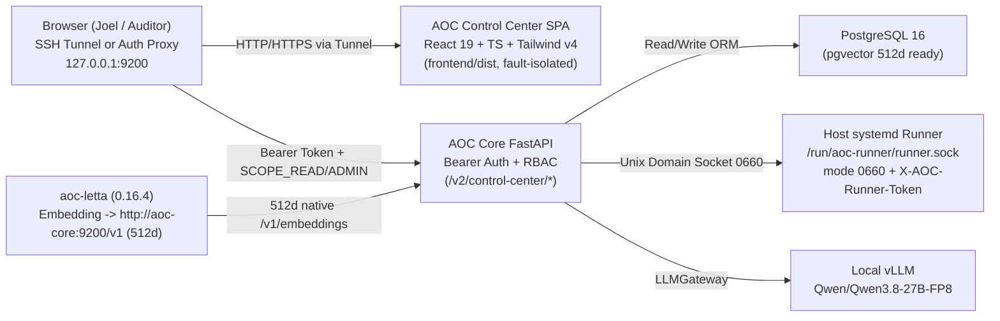

# AOC V2.1 架构与变更说明

> 版本分支：`feature/v2.1`
> 范围：可靠性修复、标准部署拓扑、AOC Control Center 后端聚合 API 与现代 SaaS Web 控制中心

---

## 1. 整体架构变更

### 核心设计原则
1. **故障完全隔离**：`frontend/dist` 静态文件挂载在 `app/api/app.py` 末尾，采用可选检测模式（可通过 `AOC_FRONTEND_DIST` 指定或关闭）。静态资源缺失、损坏或前端异常 **绝不会影响** `AutonomousLoop`、Runner 调度或任何核心 API（已通过单元测试 `test_v2_1_frontend_static_fault_isolation` 验证）。
2. **100% 真实数据与诚实审计**：Control Center 所有 10 个页面均直接读取 PostgreSQL 真实表与运行时状态，绝无 Mock/伪造数据。`Mind` 11 步决策轨迹仅渲染真实落盘的结构化记录，未执行或未落盘的步骤显式标记为“未记录”，绝不伪造隐藏 Chain-of-Thought。
3. **严格鉴权与零密钥泄露**：
   - 新增 13 个 Control Center 只读接口全部受 `require_scope(SCOPE_READ)` 保护（无 Token 返回 `401`，权限不足返回 `403`）。
   - 控制类操作（暂停、恢复、触发单周期、审批通过/拒绝、策略重检）由后端校验 `SCOPE_ADMIN` / `SCOPE_CONTROL` / `SCOPE_APPROVE`，前端根据 `/v2/auth/me` 返回的 scopes 动态隐藏未授权按钮。
   - `/v2/control-center/config` 对所有密钥、密码、Bot Token、Webhook Secret、Runner Token 及连接串凭据强制脱敏为 `***REDACTED***`。

---

## 2. 后端新增与修改模块

| 模块路径 | 变更类型 | 说明 |
|---|---|---|
| `app/api/control_center.py` | **新增** | 实现 13 个聚合只读接口（`/v2/auth/me` + 12 个 `/v2/control-center/*`），覆盖 10 大页面数据、11 步 Cycle 轨迹、跨实体跳转、Token 消耗分析及 12 配置域脱敏视图 |
| `app/api/app.py` | 修改 | 挂载 `control_center` 路由；移除 `/v1/embeddings` 512→1024 零填充；增加故障隔离的 `frontend/dist` SPA 静态挂载 |
| `app/storage/repository.py` | 修改 | 新增 `finalize_superseded_executions()` |
| `app/orchestration/orchestrator.py` | 修改 | 重试进入 `RETRY_WAIT` 时标记前序执行为已终结并记录 `superseded_by_retry=true` |
| `app/orchestration/finalizer.py` | 修改 | 任务终结时原子补齐同任务所有早先终态尝试的 `finalized_at` |
| `app/runner/service.py` | 修改 | 新增 `bind_uds_socket_0660()`，彻底修复 uvicorn 启动覆写 socket 为 `0666` 的问题 |
| `app/core/config.py` | 修改 | 统一 `MemorySettings` 默认 Embedding 模型为原生 512d (`aoc-local-embed-512`) |
| `docker-compose.yml` | 修改 | 标准化 `aoc-postgres` (`pgvector`) + `aoc-core` (UID `1000:1000` 挂载 UDS) + `aoc-letta` (直连 `aoc-core:9200/v1`) 编排 |
| `scripts/soak_monitor_72h.py` | 修改 | 新增细粒度任务/执行终结指标，清晰区分父任务已终结与父任务未终结 |
| `scripts/reconcile_v2_1_data.py` | **新增** | 幂等历史数据修复工具（回填被重试替代的执行记录 + 非破坏性归档 `AOC-E2E-*` 测试身份） |
| `scripts/migrate_pgvector.py` | **新增** | PostgreSQL `pgvector` 备份清理、类型转换、HNSW 建索引与召回/延迟验证脚本 |
| `scripts/migrate_letta_embedding_512d.py` | **新增** | Letta Agent Embedding 配置平滑迁移至 512d 工具（支持 `--dry-run` / `--execute`） |

---

## 3. AOC Control Center 页面功能清单（10 大模块）

前端源码位于 `/home/ubuntu/aoc/frontend/`（React 19 + TypeScript + Vite 6 + Tailwind CSS v4 + Recharts + Lucide Icons），支持 Dark-first / Light 主题切换、桌面/平板/移动端响应式布局、统一时间窗口筛选（1h / 6h / 24h / 7d / 全部）与可调轮询间隔（10s / 30s / 手动）。

| 页面 | 导航名 | 后端接口 | 核心能力与真实数据视图 |
|---|---|---|---|
| **A. Overview** | 生命体总览 | `GET /v2/control-center/overview` | 生命体状态/Cycle 计数、三大欲望即时卡片与趋势图、6 大核心组件健康矩阵（Core RSS / Postgres & pgvector / Runner / LLM 熔断 / Letta / Embedding）、近期 Cycle 与任务速览、管理员快捷启停/单步触发 |
| **B. Mind** | 认知与决策 | `GET /v2/control-center/cycles` `GET /v2/control-center/cycles/{id}/trace` | 按结果/欲望筛选的 Cycle 时间线；右侧重建完整 **11 步结构化决策轨迹**（Perception → Drive → Arbitration → Brain Assessment → Goal → Plan → Governance → Agent Dispatch → Result Verification → Outcome Evaluation → Post Perception），支持一键跳转关联任务，未记录步骤显式标灰“未记录” |
| **C. Drives** | 欲望系统 | `GET /v2/control-center/drives` | Survival / Reproduction / Curiosity 满意度与优先级时序曲线、各驱动多维子指标分解、仲裁历史理由列表、预期改善 vs 实测变化对比、目标状态变迁记录 |
| **D. Tasks & Agents** | 任务与执行 | `GET /v2/control-center/tasks` `GET /v2/control-center/tasks/{id}/detail` | 多条件任务搜索与分页列表、任务详情抽屉（完整关联 Cycle/Goal/Plan、状态机跃迁时间线、所有重试 Attempts 的 PID/Runner/Thread/校验明细与输出摘录）、Agent 注册表与 Host Runner 心跳状态 |
| **E. Memory** | 记忆中心 | `GET /v2/control-center/memory` | 记忆按类型/同步状态/向量状态统计、pgvector 激活状态与底层列类型提示（`jsonb` vs `vector(512)`）、Outbox 投递统计、可搜索记忆列表、Self Model 历史版本摘要 |
| **F. World** | 环境感知 | `GET /v2/control-center/world` | 自主传感器（RSS / Git / Web / System）健康度与 Checkpoint 游标、WorldEvent 去重/重要性/状态列表、World State 开放知识话题表（严格区分真实传感器与人工注入事件） |
| **G. Self Model** | 自我认知 | `GET /v2/control-center/self-model` | 当前 Self Model 版本摘要、能力成熟度矩阵（`DECLARED` / `AVAILABLE` / `ACQUIRED` / `VALIDATED` / `DEPRECATED`）与 Beta-Binomial `alpha`/`beta`/95% 置信区间可视化、近期验证证据列表、Agent 可靠性与 Skill 注册表 |
| **H. Governance** | 安全与审批 | `GET /v2/control-center/governance` | 审批队列（支持审批权用户直接批准/拒绝并强制二次校验）、策略评估审计记录（规则违规项与 L0–L3 判定）、**Token 消耗全景分析**（Codex vs Brain 占比、阶段拆分、Top 高耗任务）、风险配置提示 |
| **I. Configuration** | 配置中心 | `GET /v2/control-center/config` | 只读全景配置浏览器：涵盖 **12 个配置域**，逐项标注生效值、来源（`env` / `yaml` / `default`）、是否覆盖、重启要求、脱敏状态与风险提示，支持关键字搜索与按域筛选 |
| **J. Logs & Events** | 运行日志 | `GET /v2/control-center/logs` | 统一事件流（按级别、事件类型、Cycle ID、关键字过滤与分页），支持展开查看完整结构化 `details` JSON 载荷 |

---

## 4. 明确未变更（Out of Scope）边界确认

严格遵循 V2.1 任务书范围限制，本次迭代 **未实施** 以下越界变更：
- 未新增 Agent 类型或适配器；
- 未实现自动化 Skill 提取或代码生成；
- 未在 `AutonomousLoop` 内引入自主 MCP 工具调用；
- 未引入新的 Affect / 学习算法或修改三大驱动核心仲裁数学公式；
- 未进行任何模型微调；
- 未对生产 PostgreSQL 或生产 Letta 执行破坏性写入。
